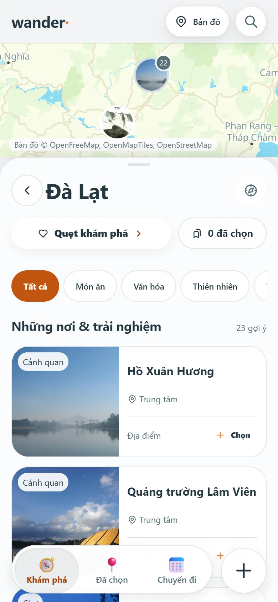
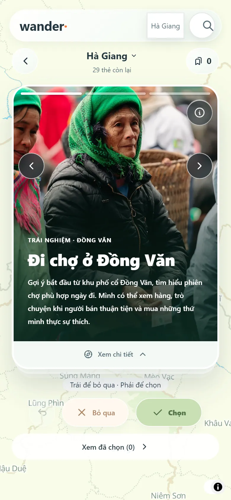
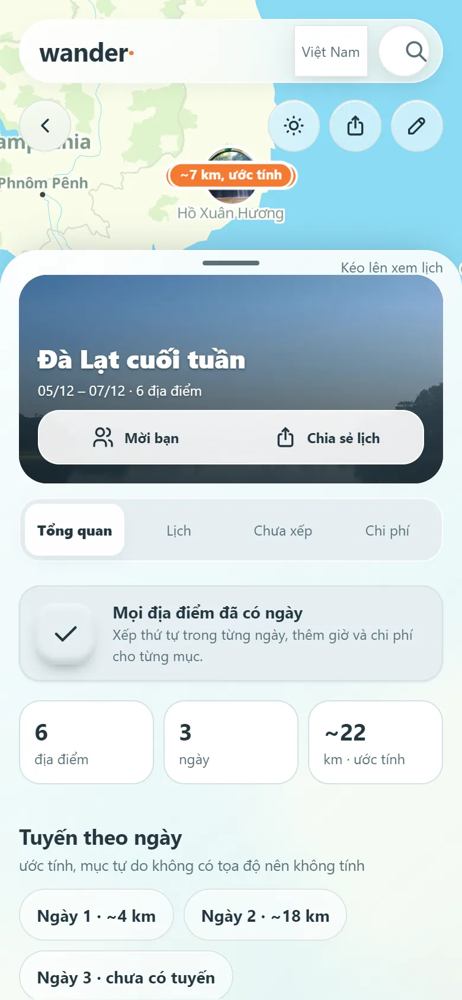
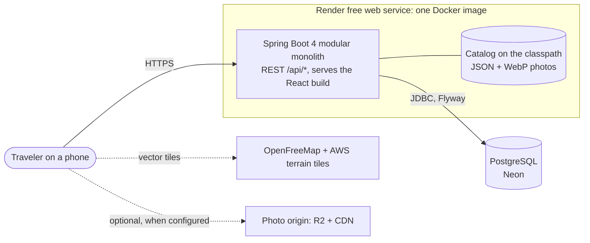
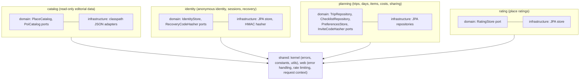

# Wander

[](https://github.com/dungv798/Wander/actions/workflows/backend-ci.yml)
[](https://github.com/dungv798/Wander/actions/workflows/web-ci.yml)
[](https://github.com/dungv798/Wander/actions/workflows/secret-scan-history.yml)

**A mobile-first trip planner for Vietnam.** Swipe through hand-curated places, turn the picks into a trip, arrange days, track costs and
share the plan: no account, no email, no phone number. The backend is a Java 21 / Spring Boot 4 modular monolith (Clean Architecture,
DDD, CQRS) on PostgreSQL; the front end is React 19 + TypeScript. The UI is in Vietnamese.

It is a personal project built to practise production backend engineering: concurrency control, an authentication/recovery design
without accounts, architecture enforced by tests, and an honest account of the trade-offs. It has not been released to real users.

**Live demo:** <https://wander-fx65.onrender.com> (Render free tier: after idle the service sleeps and the first request can take
about 70–90 seconds; measured 71 s and 87 s on a 0.25 CPU / 512 MB container). Best on a phone-sized viewport.

| Explore | Destination | Swipe deck | Trip |
|---|---|---|---|
|  |  |  |  |

<sub>Screenshots are real (Chrome, 390×844, real backend and catalog, `web/scripts/readme-shots.mjs`). Every photo carries its author, license
and source link in the catalog data and in the app.</sub>

## Architecture



Four business modules plus a shared kernel, in one deployable. Each module is layered `api → application → domain ← infrastructure`;
the domain has no Spring or JPA imports, and infrastructure implements the ports the domain declares.



No business module imports another (checked: each depends only on `shared`); `ArchitectureTest` (layers) and Spring Modulith's
`ApplicationModules.verify()` ([`ModulesTest`](backend/src/test/java/com/wander/ModulesTest.java), module diagrams in
[`docs/architecture/modules/`](docs/architecture/modules/)) keep it that way.
Write side: a command handler loads an aggregate, calls a domain method and saves it in one transaction. Read side: query services return
flat records and never load aggregates. A guided tour of the code (request lifecycle, folder map) is in
[`docs/architecture/README.md`](docs/architecture/README.md) (Vietnamese).

## Engineering highlights

Each item links to the code and to the test that proves it.

- **A concurrent-recovery race with exactly one winner.** Two devices redeeming the same single-use recovery code at once is handled
  with pessimistic row locks (`@Lock(PESSIMISTIC_WRITE)` in
  [`IdentityJpaRepository`](backend/src/main/java/com/wander/identity/infrastructure/persistence/repository/IdentityJpaRepository.java),
  `RecoveryAttemptJpaRepository`, `DeviceLinkJpaRepository`). The test fires real parallel HTTP requests, not sequential calls:
  [`RecoveryConcurrencyIT`](backend/src/test/java/com/wander/identity/RecoveryConcurrencyIT.java).
- **Optimistic locking instead of silent overwrites.** `Trip` carries `@Version`
  ([`TripEntity`](backend/src/main/java/com/wander/planning/infrastructure/persistence/entity/TripEntity.java)); a lost update returns
  `409 CONCURRENT_MODIFICATION`. [`ConcurrencyIT`](backend/src/test/java/com/wander/planning/ConcurrencyIT.java) covers it both
  deterministically (two transactions on the same version) and with parallel requests (no lost update).
- **Recovery codes are never stored.** Only an HMAC-SHA-256 keyed with a server-side pepper
  ([`HmacRecoveryCodeHasher`](backend/src/main/java/com/wander/identity/infrastructure/security/HmacRecoveryCodeHasher.java)) is kept,
  with a key version per row so the pepper can be rotated without invalidating existing codes
  ([`RecoveryKeyRotationIT`](backend/src/test/java/com/wander/identity/RecoveryKeyRotationIT.java)). The application refuses to start
  without a pepper of at least 32 bytes, and a startup guard checks that every key version still in use has its key configured.
- **Rate limiting, with its limits stated.** A fixed-window limiter per client
  ([`FixedWindowRateLimiter`](backend/src/main/java/com/wander/shared/web/ratelimit/FixedWindowRateLimiter.java),
  [test](backend/src/test/java/com/wander/shared/web/ratelimit/FixedWindowRateLimiterTest.java)) with correct client addressing behind
  proxies (trusted-hop count, IPv6 collapsed to /64). It lives in memory, so it is only correct for one instance: see
  [limitations](#known-limitations-and-roadmap).
- **A typed API contract, generated end to end.** Every endpoint takes and returns typed records (no `Map` in a controller: ArchUnit rule
  `API-1`); errors are RFC 9457 `application/problem+json` with a stable `code` and the request id; the OpenAPI 3.1 document is generated by
  the application, committed as [`backend/openapi.yaml`](backend/openapi.yaml) and checked for staleness by a test, and the web client's
  TypeScript types are generated from it (CI fails on drift). The generated types caught a real inconsistency on first use. Decision,
  trade-offs and the intentional behaviour changes: [ADR-017](docs/architecture/adr/ADR-017-typed-api-contract.md),
  [`docs/architecture/api-contract.md`](docs/architecture/api-contract.md).
- **A transactional outbox, tested for the failure modes.** Security events are published inside the transaction and recorded after
  commit by an idempotent listener (Spring Modulith event publication registry, Flyway-owned table). Tests prove: a rolled-back
  transaction publishes nothing, delivering the same event twice leaves one row, a failing listener leaves a `FAILED` publication that
  can be resubmitted. [`docs/architecture/events.md`](docs/architecture/events.md),
  [`SecurityEventOutboxIT`](backend/src/test/java/com/wander/identity/SecurityEventOutboxIT.java). (Honest note: the modules never called
  each other, so this first use is an in-module decoupling, explained in the document.)
- **Observability you can run.** `X-Request-Id` on every response, repeated as `requestId` in error bodies and in every log line; JSON logs
  on the public profile; Prometheus metrics (HTTP by route template, rate-limit rejections, outbox deliveries) with a local
  Prometheus + Grafana stack (`docker compose --profile observability`). Verified by running it:
  [`docs/operations/observability.md`](docs/operations/observability.md).
- **Performance with numbers, and a guard against N+1.** A trip read prepares 6 SQL statements and the trip list 2, whether the data is
  1 item or 25 ([`QueryCountIT`](backend/src/test/java/com/wander/planning/QueryCountIT.java), fails the build otherwise). k6 results on a
  developer machine and in the 0.25-CPU deployment shape, with what they do not show: [`docs/performance.md`](docs/performance.md).
- **Architecture as tests.** [`ArchitectureTest`](backend/src/test/java/com/wander/ArchitectureTest.java) has 21 ArchUnit rules: layer
  direction, a pure domain, queries never load aggregates, `@Transactional` only in the application layer, no cycles, typed controllers,
  naming and package conventions. Coverage floors and Checkstyle (zero warnings) are part of `./gradlew check`.
- **Real-database integration tests.** 43 `*IT` classes start the whole application against PostgreSQL in Testcontainers; browser tests
  drive real Chrome against the real backend at phone size (126 scenarios).
- **A reproducible photo pipeline.** 589 catalog photos are re-encoded to content-hashed WebP (480 px and 1280 px, metadata stripped),
  served with a one-year `immutable` cache, and can be moved to object storage by one environment variable
  ([ADR-016](docs/architecture/adr/ADR-016-photo-delivery.md), [`optimize-photos.mjs`](tools/catalog/optimize-photos.mjs),
  [`upload-photos.mjs`](tools/catalog/upload-photos.mjs) whose request signing is checked against the official AWS test vectors).
  Photo data went from 261,159,915 to 133,041,404 bytes and the image bytes of one destination page from 7.5 MB to 1.9 MB.

## Testing and quality

Measured on 2026-11-12 with `make verify`-equivalent commands (Docker running):

| What | Result |
|---|---|
| Backend (`./gradlew clean check`) | 444 tests (unit, ArchUnit, 43 Testcontainers IT classes): 443 passed, 1 skipped by design (module-diagram regeneration, opt-in), 0 failures |
| Coverage (JaCoCo) | 97.6 % line, 87.3 % branch; gates: bundle ≥ 90 % / 70 %, domain + application packages ≥ 90 % / 50 % |
| Static analysis | Checkstyle with zero warnings |
| Web | typecheck, ESLint, stylelint; 505 unit tests |
| End to end | 126 browser scenarios against the real backend |
| CI | `backend-ci` (check, gitleaks, Trivy on the jar), `web-ci`, weekly full-history secret scan. Added and **not yet run on GitHub**: `e2e` (the same `tools/e2e.sh`), `codeql` (Java, TypeScript) and Dependabot |

Baseline numbers and how they were measured: [`docs/baseline.md`](docs/baseline.md).

## Run it locally

Needs Docker (running), JDK 21, Node 24+, and Chrome or Edge for the browser tests.

```bash
make doctor      # check the toolchain
make run         # PostgreSQL in Docker, build the web app, start the backend on http://localhost:8787
                 # (set WANDER_RECOVERY_PEPPER to a random string of at least 32 bytes first)
make check       # backend gate: tests, ArchUnit, Checkstyle, JaCoCo
make web-check   # typecheck, lint, unit tests
make e2e         # browser scenarios on a scratch database
make verify      # everything
```

Windows users without `make` can use `powershell -ExecutionPolicy Bypass -File tools\dev.ps1 <doctor|run|backend-test|e2e|verify>`. The Vietnamese
[`README.vi.md`](README.vi.md) has the full guide (environment variables, troubleshooting). Backend and web specifics:
[`backend/README.md`](backend/README.md), [`web/README.md`](web/README.md).

iOS Safari has two manual simulator workflows (`ios-safari-sim.yml`, `ios-safari-autoscroll.yml`) for checks Chrome cannot reproduce.
How AI assistance is used on this repository, and who decides what: [`docs/ai-assisted-workflow.md`](docs/ai-assisted-workflow.md).

## Decisions (ADR index)

Records are in Vietnamese with an English title and summary at the top of each.

| ADR | Decision |
|---|---|
| [002](docs/architecture/adr/ADR-002-java-spring-stack.md) | Java/Spring, Clean Architecture, DDD, CQRS, PostgreSQL, AWS target; TypeScript front end |
| [003](docs/architecture/adr/ADR-003-modules-layers-cqrs.md) | Modular monolith; four layers per module; commands return ids, queries return flat read models |
| [004](docs/architecture/adr/ADR-004-java21-spring-boot-4.md) | Java 21 + Spring Boot 4.1 |
| [005](docs/architecture/adr/ADR-005-spring-security-bearer.md) | Spring Security with self-managed opaque bearer tokens (hashed in the database) |
| [006](docs/architecture/adr/ADR-006-aws-fargate-cdk.md) | AWS direction (Fargate, ALB, RDS, CloudFront, CDK); on hold, deployment runs on Render + Neon |
| [007](docs/architecture/adr/ADR-007-remove-legacy-ts-server.md) | Remove the prototype TypeScript server |
| [008](docs/architecture/adr/ADR-008-mapstruct.md) | MapStruct for entity ↔ domain mapping, infrastructure only |
| [009](docs/architecture/adr/ADR-009-nguon-dia-diem-mien-phi.md) | Free, hand-curated place data behind a `PlaceCatalog` port |
| [010](docs/architecture/adr/ADR-010-module-catalog.md) | A read-only `catalog` module; photos public, data validated at startup |
| [011](docs/architecture/adr/ADR-011-spring-modulith-va-outbox.md) | Spring Modulith and an event outbox when the fourth module exists |
| [012](docs/architecture/adr/ADR-012-chien-luoc-cache.md) | Cache policy first (HTTP caching), Caffeine only when measured |
| [013](docs/architecture/adr/ADR-013-cong-chat-luong-trong-gradle.md) | Quality gates are Gradle tasks; CI only runs them |
| [014](docs/architecture/adr/ADR-014-kind-va-interests-cua-chuyen.md) | Trip kind and interests: vocabulary owned by `planning`, parity-tested against the catalog |
| [015](docs/architecture/adr/ADR-015-maplibre-openfreemap.md) | MapLibre GL + OpenFreeMap + terrain hillshade, no API key |
| [016](docs/architecture/adr/ADR-016-photo-delivery.md) | Optimized WebP on the classpath now, object storage + CDN when configured |
| [017](docs/architecture/adr/ADR-017-typed-api-contract.md) | Typed request/response records, RFC 9457 errors, generated OpenAPI and TypeScript types; paths stay unversioned |
| [018](docs/architecture/adr/ADR-018-rate-limiter.md) | Keep the small in-memory fixed-window limiter; alternatives and when to replace it |

## Known limitations and roadmap

- **Rate limiting is per process.** The limiter is in memory, so with more than one instance each would count separately. Single
  instance is deliberate for now; a Postgres- or Redis-backed limiter is the path for scaling out.
- **The outbox has one use and no retention job.** Only the security-event log goes through it, and completed publications are kept
  (nothing prunes them yet); failed ones are resubmitted by a call or a restart, not on a schedule. See
  [`docs/architecture/events.md`](docs/architecture/events.md).
- **Metrics are not published on the public instance** (the free profile exposes only `health`): to see production numbers you would add
  a managed Prometheus/Grafana, which is a cost decision. Tracing and alert rules are not done
  ([`docs/operations/observability.md`](docs/operations/observability.md)).
- **Performance is measured on a developer machine and in a CPU-limited container, not on Render/Neon**; at 10 simultaneous users the
  quarter-CPU shape saturates (p95 about 1.1 s) with no errors ([`docs/performance.md`](docs/performance.md)).
- **The catalog is small and hand-curated**: 20 destinations, 704 places, 578 place photos and 153 moments; not every place has a photo or
  a price. Travel times are estimates (straight-line distance times a factor), not routing.
- **No real-time sync** between collaborators and **no offline mode**; the session secret is kept in `localStorage` (release gate RG-6 is
  still open, so the app is not offered to real users).
- **Free hosting sleeps when idle** (see the live-demo note); a keep-warm workflow pings the health endpoint, which reduces but does not
  remove cold starts.
