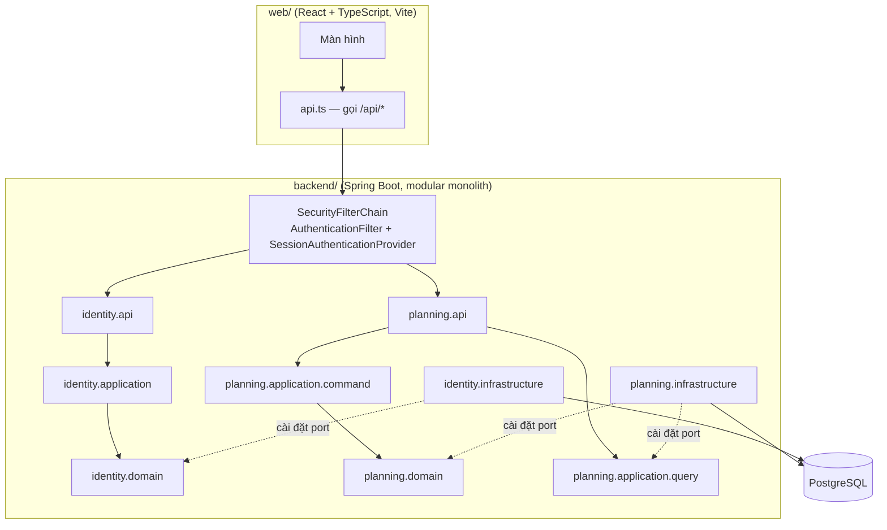

# Kiến trúc Wander — đọc để hiểu và để học

Stack: **Java 21 · Spring Boot 4 · Clean Architecture · DDD · CQRS · JPA/Hibernate · PostgreSQL · (AWS) · giao diện React + TypeScript**.
Quyết định: [ADR-002](adr/ADR-002-java-spring-stack.md) (`APPROVED`), [ADR-003](adr/ADR-003-modules-layers-cqrs.md) (`PROPOSED`).
Câu hỏi kỹ thuật còn chờ PO: [open-decisions.md](open-decisions.md). AWS: [aws-deployment.md](aws-deployment.md).

## 1. Bức tranh lớn

## 2. Một yêu cầu đi qua hệ thống (ví dụ: thêm mục)

1. `POST /api/trips/{id}/items` → `ResponseHeadersFilter` (header) → chuỗi Spring Security (`SecurityConfig`: `AuthenticationFilter` đọc Bearer, `SessionAuthenticationProvider` kiểm tra phiên ở DB, đặt `AuthenticatedPrincipal` vào SecurityContext; ADR-005).
2. `TripController.addItem` nhận `JsonBody` (JSON thô, ≤ 64 KB) và principal.
3. Gửi lệnh `PlanningCommands.AddItem` tới `PlanningCommandHandler` (một giao dịch):
   nạp `Trip` qua `TripRepository` → kiểm tra nhập liệu bằng `RawInput` (D17: "1.5" là MALFORMED) → `trip.addItem(...)` giữ bất biến thứ tự → lưu.
4. `JpaTripRepository` chép trạng thái domain vào `TripEntity`/`ItemEntity`; Hibernate sinh SQL khi commit; `@Version` chống ghi đè.
5. Controller gọi `PlanningQueries.item(...)` (phía đọc, JPQL projection) và trả `{ "item": ... }`.
6. Lỗi nghiệp vụ là `WanderException(kind, code, field)`; `ApiExceptionHandler` đổi `kind` → mã HTTP. Domain không biết HTTP.

## 3. Bản đồ thư mục

| Đường dẫn | Nội dung |
|---|---|
| `backend/src/main/java/com/wander/shared/kernel` | `constant/` (hằng số nền và hệ thống, mã và lời báo lỗi dùng chung) · `error/` (`WanderException`, `ErrorKind`) · `util/` (`Texts`, `Ids`, `Patch`, `Timestamps`, `CodedValue`...) · `security/` (`AuthenticatedPrincipal`) |
| `backend/src/main/java/com/wander/shared/web` | `error/` (bắt lỗi → JSON) · `request/` (đọc thân JSON, địa chỉ người gọi, principal) · `ratelimit/` · `filter/` (header bảo mật) · `config/` (cấu hình web, phục vụ `web/dist`) · `constant/` (`HttpConstants`) |
| `…/planning/api` | `controller/` (`TripController`) · `constant/` (đường dẫn, khóa JSON) |
| `…/planning/domain` | `model/` (`Trip` aggregate root, `Item`, `ItemCost`, `DateRange`...) · `vocabulary/` (enum: `ItemType`...) · `rule/` (`ItemText`, `Vnd`) · `constant/` · `port/` (`TripRepository`) |
| `…/planning/application` | `command/` (lệnh + handler), `query/` (read model + `PlanningQueries`), `input/RawInput` |
| `…/planning/infrastructure/persistence` | `entity/` · `adapter/` (`JpaTripRepository`, `JpaTripReadModel`) · `mapper/` (MapStruct) · `constant/` (JPQL) |
| `…/identity/**` | Cùng cấu trúc; Spring Data JPA repository; **RG-1: thiết kế chưa duyệt** |
| `backend/src/main/resources/db/migration` | Flyway SQL |
| `backend/src/test/java` | `ArchitectureTest` (ArchUnit), test domain thuần, test API tích hợp (`*IT`, Testcontainers) |
| `web/` | Giao diện React + TypeScript (không đổi) |
| `e2e/` | 6 kịch bản trình duyệt thật (24/10/2026), chạy với backend Java (`tools/dev.ps1 e2e`) |
| `tools/dev.ps1` | Lệnh phát triển trên Windows, ghi log vào `.logs/` |

## 4. Kiểm thử (kim tự tháp)

| Tầng | Ví dụ | Chạy |
|---|---|---|
| Luật kiến trúc | `ArchitectureTest` | mili-giây |
| Domain thuần | `TripTest`, `RawInputTest`, `SecretsTest` | mili-giây, không Spring |
| API tích hợp | `PlanningApiIT`, `RecoveryApiIT`, `RateLimitIT`, `StaticWebIT` — app thật + PostgreSQL thật (Testcontainers) | vài chục giây, cần Docker |
| Đầu-cuối | `e2e/browser.test.ts` — Edge/Chrome thật, khung nhìn điện thoại | phút |

Lệnh: `powershell -ExecutionPolicy Bypass -File tools\dev.ps1 backend-test` (hoặc `verify` để chạy tất cả).

## 5. Công thức thêm một tính năng (ví dụ "đánh dấu mục đã đặt chỗ", A-14 — đang chờ Q14)

1. **Truy nguồn**: story/quy tắc nào trong master plan, trạng thái gì? Nếu dựa vào ❓/🔶 ⇒ dừng, hỏi PO (`/wander-decision-audit`).
2. **Domain**: thêm trường/VO và hành vi vào aggregate (`Item.markBooked`), viết test domain trước (`TripTest`).
3. **Migration**: `V2__booking_status.sql` (không sửa V1 đã chạy).
4. **Infrastructure**: thêm cột vào entity + ánh xạ trong adapter; Hibernate `validate` sẽ báo nếu lệch.
5. **Application**: lệnh mới trong `PlanningCommands` + handler; nếu cần hiển thị, thêm trường vào read model và JPQL.
6. **API**: endpoint mỏng trong controller; giữ quy ước lỗi.
7. **Test tích hợp** trong `PlanningApiIT`; nếu đổi giao diện thì thêm/sửa e2e.
8. Chạy `tools\dev.ps1 verify`; nhờ agent `wander-code-reviewer` rà; cập nhật `docs/implementation/decisions.md`.

## 6. Học từ code — khái niệm và chỗ xem

| Khái niệm | Xem ở đâu | Điểm đáng chú ý |
|---|---|---|
| Aggregate root, bất biến | `planning/domain/model/Trip.java` | Chỉ `Trip` đổi vị trí mục; vị trí luôn 0..n-1 |
| Value object | `ItemCost`, `DateRange` | Không thể tồn tại ở trạng thái sai (kiểm tra trong constructor) |
| Port & adapter | `TripRepository` ↔ `JpaTripRepository`; `IdentityStore` ↔ `JpaIdentityStore` | Domain định nghĩa interface, infrastructure cài đặt |
| CQRS | `PlanningCommandHandler` vs `PlanningQueries` + `JpaTripReadModel` | Lệnh trả id; truy vấn trả record phẳng |
| Khóa lạc quan | `TripEntity.version`, `OPTIMISTIC_FORCE_INCREMENT` | 409 thay vì mất dữ liệu khi hai người sửa (chuẩn bị cho 1b) |
| Khóa bi quan | `RecoveryCodeJpaRepository.lockById` (`@Lock`) | Hai lần khôi phục cùng mã ⇒ một thắng |
| Thứ tự flush Hibernate | `JpaIdentityStore.invalidateRecoveryCode` | INSERT chạy trước UPDATE ⇒ phải flush sớm |
| N+1 | `hibernate.default_batch_fetch_size`, `left join fetch` | Giống bài toán gom 4 truy vấn trong CV |
| Spring Data JPA | `*JpaRepository` trong identity | Truy vấn suy diễn từ tên, `@Query`, `@Modifying` |
| Testcontainers | `support/ApiTestSupport.java` | PostgreSQL thật, container dùng chung cho mọi lớp test |
| Kiến trúc thành test | `ArchitectureTest.java` | "Tài liệu kiến trúc chạy được" |
