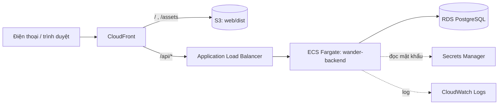

# Triển khai trên AWS — đề xuất (`PROPOSED`, CHƯA DUYỆT, CHƯA TẠO TÀI NGUYÊN)

> Bị chặn bởi **RG-1** (thiết kế xác thực Q16 chưa duyệt) và **RG-5** (chưa sẵn sàng triển khai).
> Không được tạo tài nguyên AWS, khóa bí mật hay pipeline triển khai khi PO chưa duyệt AD-2/AD-3.

## 1. Code đã "sẵn sàng cho AWS" thế nào

| Yêu cầu của AWS | Đã có trong code |
|---|---|
| Cấu hình theo môi trường (12-factor) | `application.yml` đọc `WANDER_DB_URL`, `WANDER_DB_USER`, `WANDER_DB_PASSWORD`, `PORT`, `WANDER_BIND_ADDRESS`, `WANDER_WEB_DIR`, `WANDER_LIMIT_*` |
| Đóng gói container | `backend/Dockerfile` (JRE 21 Alpine, user không phải root, HEALTHCHECK) |
| Health check cho load balancer | `GET /actuator/health` (+ liveness/readiness probe) |
| Schema có phiên bản | Flyway chạy khi khởi động |
| Tắt êm | `server.shutdown=graceful` |

## 2. Kiến trúc đề xuất (phương án học sát công việc)

## 3. Phương án so sánh

| | App Runner | ECS Fargate + ALB | Elastic Beanstalk |
|---|---|---|---|
| Độ phức tạp | Thấp nhất | Trung bình (VPC, subnet, SG, ALB, task def) | Thấp–trung bình |
| Học được | Ít | Nhiều nhất, giống doanh nghiệp | Trung bình |
| Chi phí khi ít người dùng | Thấp | Cao hơn (ALB tính theo giờ) | Trung bình |

Chi phí cụ thể: `UNVERIFIED` — cần tra AWS Pricing Calculator cho vùng `ap-southeast-1` trước khi chọn.

## 4. Những điểm phải sửa trước khi chạy sau load balancer
- Giới hạn tần suất đang theo địa chỉ kết nối trực tiếp ⇒ sau ALB mọi người cùng một địa chỉ. Cần đọc `X-Forwarded-For` tin cậy (`server.forward-headers-strategy`) và kho đếm dùng chung (AD-6).
- Phiên lưu `localStorage` (RG-6) — chờ AD-1.
- Sao lưu và giữ dữ liệu (OQ-1): bật automated backup của RDS, chính sách giữ dữ liệu cần PO quyết.
