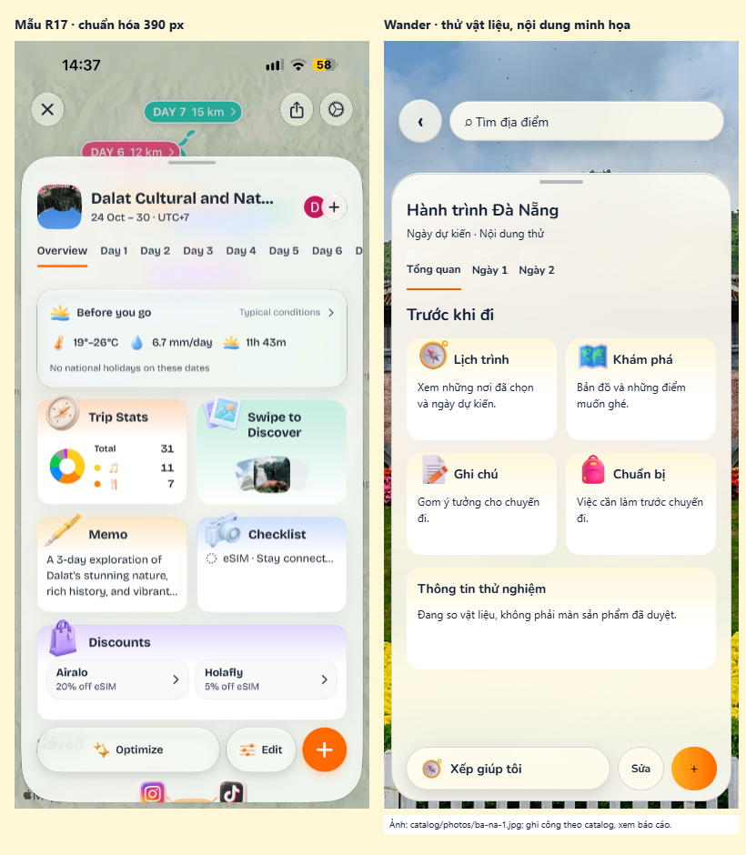
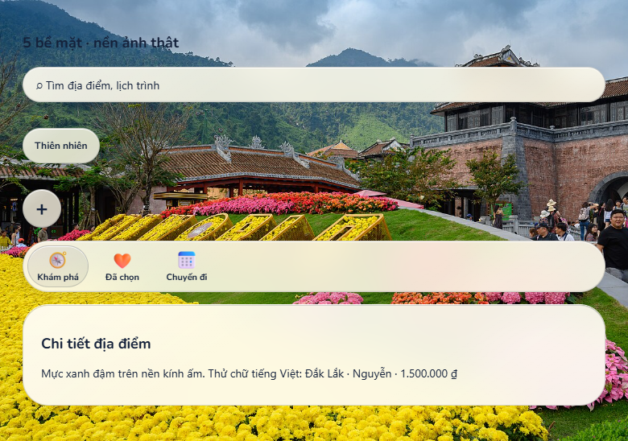
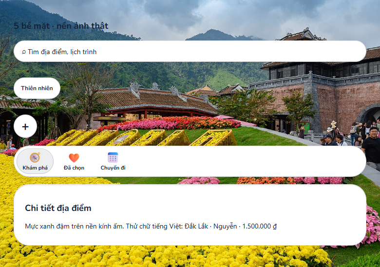
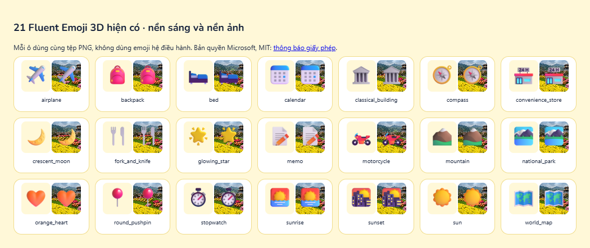

# Roameo → đặc tả dựng lại cho Wander

Ngày khảo sát: 29/10/2026. **Đề xuất để PO duyệt, chưa thay nhận diện hay mã sản phẩm.** Đọc lần lượt: kết luận → ảnh kiểm kê → chữ → kính → icon → bố cục → quyết định. Chạy `node docs/design/glass-trial/capture.mjs --serve`, mở URL được in để xem [trang thử](glass-trial/index.html), Ctrl+C để dừng; không mở trực tiếp bằng `file://` vì đường dẫn tài nguyên bắt đầu từ gốc repository.

## Kết luận có thể hành động

**VERIFIED:** đã xem tất cả 37 ảnh qua 10 bảng ảnh, mỗi ảnh giữ toàn màn ở chiều rộng 390; xem thêm các crop phóng 2× của R03, R15, R17, R31, R34. 36 ảnh đầu là Roameo; R37 là màn thanh toán TikTok Shop, loại khỏi suy luận về Roameo. Bản crop R37 che vùng thông tin cá nhân. Không suy ra màn hình từ tên tệp. [Manifest đầy đủ](crops/manifest.json) nối ID với tên tệp và kích thước gốc; bảng cuối tài liệu ghi từng ảnh.

**INFERENCE:** cảm giác “nịnh mắt” đến từ chữ sans đầu nét mềm, nhịp chữ gọn, sheet lớn đặt trên bản đồ, vật liệu trắng pha nền rất nhẹ, icon 3D pastel và sự phân cấp ổn định. Không có bằng chứng rằng chỉ cần chạy trên iOS sẽ đẹp hơn. **UNVERIFIED:** tên font trong binary Roameo, framework native/React Native/Flutter, iOS version, chuyển động, hiệu năng và vật liệu iOS 26 thực sự.

**Đề xuất:** body hệ thống trên Apple, display hệ thống rounded nếu trình duyệt cung cấp; Nunito dự phòng. Đừng tiếp tục dùng Baloo 2 để giả font mẫu: Baloo có hình chữ trang trí và độ đậm khác. Trước khi chốt, PO cần so chữ và icon trên cùng một màn, không đánh giá chỉ bằng tên font.

## 1. Cách đo và phạm vi bằng chứng

Tất cả ảnh gốc là **1290×2796 px (VERIFIED)**. 430×932 CSS px ở DPR 3 là **INFERENCE**, khớp một nhóm iPhone lớn, chưa xác nhận thiết bị. Để dựng Wander ở viewport chuẩn 390×844, toàn bộ số đo dưới đây dùng **px quy đổi ở rộng 390**: `đo_gốc × 390 / 1290`; tọa độ y cũng nhân cùng tỉ lệ, không kéo méo ảnh. Muốn so với giả thiết iPhone rộng 430, nhân 430/390. Không coi px ảnh là CSS px.

Các crop `Rnn-top.png`: x=0, y=round(0,07H), w=W, h=round(0,34H); `bottom`: x=0, y=round(0,72H), w=W, h=floor(0,28H); lưu ở rộng 780. `full`: toàn ảnh ở rộng 390. Sai số hình học khoảng ±2–4 px quy đổi do JPEG, bo góc mềm và đọc ranh giới bằng mắt. Cỡ chữ/weight/tracking/blur là **INFERENCE**, không thể đảo ngược chính xác CSS từ bitmap. Không có số đo font “VERIFIED” giả.

| Bằng chứng | Đọc được gì | Mức chắc chắn |
|---|---|---|
| [R03 đáy](crops/R03-bottom.png) | pill tab, 3 mục, active pill bên trong, nút + tách riêng; mép sáng và viền xám | VERIFIED |
| [R17 đáy](crops/R17-bottom.png) | nút Optimize mờ xuyên nhẹ, bóng dưới; Edit; CTA + cam đặc | VERIFIED |
| [R31 đầu](crops/R31-top.png) | đầu sheet, tên, rating, giờ mở, tab Photos/Posts | VERIFIED |
| [R34 đầu](crops/R34-top.png) | chữ tiêu đề và thân, card trắng, bo, thanh kéo | VERIFIED |
| [R15 đầu](crops/R15-top.png) | tiêu đề New collection và preview folder | VERIFIED |

## 2. Tính năng: đối chiếu thật với Wander

Đã đọc `docs/ux/screens.md` và nguồn hiện tại. **“Có” nghĩa là có đường mã/component, không phải đã chạy backend hay E2E.** Tài liệu screens mô tả prototype, có thể cũ hơn React. Không dùng bảng prototype để kết luận tính năng React đã hoàn tất. R11/R12 là lịch mẫu công khai, R17/R26 là chuyến riêng; quyền khác nhau.

### Những phần đã có hoặc có một phần

| Trong mẫu / ảnh, vùng | Wander / bằng chứng mã đã đọc | Kết luận |
|---|---|---|
| Bản đồ + sheet + tab ngày R11/R17 đầu | `trips/components/TripScreen.tsx`: `useBottomSheet`, tab ARIA; `TripMap.tsx`: marker, tuyến, camera inset | VERIFIED có khung; không cần viết lại thành một tính năng mới |
| Chọn/chỉnh nơi theo ngày R27 | `DeckScreen.tsx` có adding mode, chọn bằng nút/cử chỉ; `TripScreen.tsx` mở mục/chọn ngày | VERIFIED có mục tiêu tương đương, chưa có chính xác list chọn nhiều của mẫu |
| Trip Ideas / Copy Itin R12/R14 | `templates/components/TemplatesSection.tsx`, `TemplateSheet.tsx`, `trips/hooks/useCreateFromTemplate.ts` | VERIFIED có lịch mẫu và tạo chuyến theo ngày từ mẫu; thiếu feed xã hội xếp hạng |
| Danh sách chuyến R07/R08 | `TripsScreen.tsx`, `TripCard.tsx` | VERIFIED có; chưa có thanh search/filter/sort như mẫu |
| Memo/checklist/stats R12/R17 | `OverviewTab.tsx`, `ChecklistSection.tsx`, `collab/api/CollabGateway.ts` | VERIFIED có thống kê, checklist nhóm, các trường ghi chú; không đồng nghĩa card Memo độc lập giống mẫu |
| Save địa điểm R29 | `PickedScreen.tsx`, `discoverState.ts` và `screens.md` S5 | VERIFIED có danh sách đã chọn; không phải nhiều collection đặt tên |
| Key takeaways/ảnh/thông tin R30/R31 | `place/PlaceBody.tsx`: QuickFacts, About thu gọn, Tips, Credits; `PlaceGallery.tsx` | VERIFIED tương đương biên tập; không có rating Google. `EditorialRate` ghi rõ DR-007 thay sao bằng nhãn biên tập |
| Đặt chỗ R34 Reserve | `trip.types.ts`, `HttpTripsGateway.ts`: booking pending/booked; S7b | VERIFIED chỉ trạng thái đặt chỗ tự nhập; chưa tích hợp mua vé |
| Share R11/R17 | `collab/api/CollabGateway.ts`: invite/join/member/checklist; `ExportScreen.tsx` | VERIFIED có API FE mời nhóm; xuất ảnh/PDF/lịch vẫn disabled, chỉ preview; runtime backend UNVERIFIED |
| Optimize R17 | `model/planDays.ts`: gần nhất theo đường chim bay, chia số mục | VERIFIED có gợi ý xếp, **không** phải AI/tối ưu tuyến theo đường và giờ mở |

### Khoảng thiếu được xếp theo giá trị lập lịch

S = khoảng 0,5–2 ngày, M = 3–7 ngày, L = >1 tuần **INFERENCE** cho một người đã hiểu code; không phải cam kết. Thứ hạng là giá trị/lượng công, không phải yêu cầu đã duyệt. “Chưa có” giới hạn ở các feature/component/API FE đã kiểm kê; không khẳng định toàn backend không có endpoint chưa được đọc.

| Hạng | Thiếu / ảnh + vùng | Cách làm, vì sao đáng làm | Cỡ / backend | Chắc chắn |
|---|---|---|---|---|
| 1 | Search/filter/sort chuyến R08–R10, hàng đầu + sheet | Lọc sắp đi/đã qua, sắp theo ngày, tìm tên; giảm tìm kiếm khi có nhiều chuyến; giữ bộ lọc khi đóng sheet | S; dùng dữ liệu FE đã tải, phân trang server mới cần API | VERIFIED chưa thấy trong `TripsScreen.tsx` |
| 2 | Danh sách chọn nhiều để thêm vào ngày R27, thân | Một lần chọn 3–5 nơi rồi “Thêm vào Ngày n”, giữ đường quẹt hiện tại; giảm vòng mở/đóng | M; kiểm tra API thêm lô hoặc dùng lệnh hiện có + báo lỗi từng phần | INFERENCE thiếu đúng flow này |
| 3 | Ước tính di chuyển giữa các điểm R11, khoảng giữa card | Nói rõ ước tính; chọn đi bộ/xe khi có dữ liệu. Lợi ích trực tiếp: ngày không quá tải | L; routing provider, quota/chi phí, tọa độ, cache; Tầng A | VERIFIED mã chỉ dùng `roadKmBetween` ước tính, không routing đa phương tiện |
| 4 | Collection nhiều danh sách R02/R03/R15 | Tên/cover/icon, lưu ý tưởng chưa thành chuyến. Giá trị khi số đã chọn lớn; tránh ép tạo chuyến sớm | M; schema owner→collection→place, đồng bộ, quyền; Tầng A | VERIFIED chưa có feature collection; picked hiện có chỉ một tập |
| 5 | Mở website/reserve/call R34 phần Visit details | Chỉ liên kết nguồn đã biên tập, tách khỏi “Đã đặt”; giảm công tìm vé | M; bổ sung trường URL/phone và kiểm nguồn, không tự crawl giá | INFERENCE chưa có UI này trong PlaceBody |
| 6 | Nhập URL/ghi chú thủ công R25 ô Notes or links | Bắt đầu từ lưu URL + ghi chú, sau đó xem trước và xác nhận địa điểm; hữu ích hơn AI hoàn toàn tự động ở giai đoạn đầu | M; trường URL/nguồn, xác thực/SSRF nếu server fetch; Tầng A | VERIFIED chưa có flow nhập ở feature hiện tại |
| 7 | Weather/holiday R17 card Before you go | Hiện điều kiện điển hình có nguồn/ngày cập nhật, không giả là dự báo | M; provider thời tiết/lịch lễ + cache, định nghĩa forecast vs climate | INFERENCE thiếu; QuickFacts hiện có mùa đẹp, không weather |
| 8 | Social/screenshot extraction R18–R25 | Tách “nhập” khỏi “tự chốt”: review kết quả rồi lưu. Có ích nhưng tải nền, định danh và chống trùng phức tạp | L; OCR/LLM/API ngoài, job, provenance, quota; Tầng A | VERIFIED chưa có flow này |
| 9 | Want to go/Visited + review/public reaction R28–R32 | Ghi nhận đã đi trước, cộng đồng sau; không bịa số lượt/rating để làm đẹp | L; schema visibility, moderation, spam/privacy, auth; Tầng A | VERIFIED chưa có feature review; trái hướng nhãn biên tập nếu thay trực tiếp |
| 10 | Friends toàn cục R13 | Khác thành viên của từng chuyến; lợi ích thấp hơn mời bằng link hiện có | L; user directory, discoverability, privacy; Tầng A | VERIFIED CollabGateway có thành viên chuyến, không friends search |
| 11 | Discount/eSIM/Pro/quota R12/R16/R17 | Tạm hoãn: không giúp lập lịch bằng các mục đầu; có thể tăng nhiễu và thay mục tiêu sản phẩm | L; đối tác/payment/entitlement; Tầng A | VERIFIED không thấy feature thương mại tương ứng |
| 12 | Passport/footprints R03 tab đáy | Chỉ thấy tên tab; màn nội dung không có trong bộ ảnh. Không đưa vào backlog chắc chắn chỉ vì app store nhắc | L nếu bản đồ đã đi; backend visit history | UNVERIFIED trong ảnh |

**Ưu tiên bổ sung ngoài bằng chứng ảnh:** hoàn thiện xuất PDF/ảnh/lịch hiện có giúp dùng lịch khi đi đường, nhưng ảnh không chứng minh trực tiếp flow xuất của Roameo. Không gán nó thành “thấy trong mẫu”.

## 3. Chữ: nhận diện thay vì đoán theo hệ điều hành

### Hình học chữ

| Dấu hiệu / vị trí | Quan sát từ ảnh | Suy ra được gì |
|---|---|---|
| `a` trong Ba Na, `g` trong Google, R31-top | a hai tầng, g có vòng dưới mở theo dạng một tầng; lỗ chữ khá thoáng | VERIFIED hình dạng ở mức crop; INFERENCE gần họ SF rounded; không đủ độc nhất để nhận tên |
| `y` trong Your, `t` trong Trip, R17/R15 | đuôi y cong, đầu nét/tay t mềm; nét đều, chữ đậm không có “bọng” trang trí | INFERENCE hợp SF Pro Rounded hơn Baloo 2; Nunito vẫn là ứng viên |
| `1`, `7` R11 giờ/R17 stats | 1 có đầu xiên, 7 không thấy gạch ngang; số nhỏ không đủ phân biệt chân 1 | VERIFIED nhìn thấy số; chi tiết chân UNVERIFIED do JPEG |
| Dấu Việt R31 nền bản đồ “Giếng Trời”, R27 danh sách | có dấu nhưng là tên địa điểm nhỏ, có thể map engine dùng font khác; “Ba Na” không có dấu | Không dùng font map làm bằng chứng font app. Bộ Việt của font app gốc UNVERIFIED |
| Weight/tracking R31 tiêu đề vs R34 body | tiêu đề đậm hơn, không nghiêng; body có chiều cao chữ thường lớn, hàng khá sát | INFERENCE title 650–750, body 400–500; tracking gần 0 hoặc hơi âm |
| Logo Roameo R07/R14 | serif đậm tương phản, khác hẳn nội dung | VERIFIED không phải body font. Không dùng New York/serif cho mọi tiêu đề vì logo |

Kết luận nhận diện: **SF Pro Rounded là giả thuyết dẫn đầu cho tiêu đề, SF Pro hoặc rounded cho thân — INFERENCE, chưa xác nhận font gốc.** New York là serif nên không khớp UI sans; chỉ logo có serif nhưng chưa biết tên. Không tuyên bố “100% SF” chỉ vì thấy Dynamic Island.

### Tra cứu đúng sản phẩm

[App Store đúng app, id6748898199](https://apps.apple.com/us/app/roameo-ai-trip-planner/id6748898199), [Play đúng package com.roameo.app](https://play.google.com/store/apps/details?id=com.roameo.app&hl=en), cùng nhà phát triển Silvertree Ventures. Listing mô tả quẹt nhóm, nhập cảm hứng và lập lịch; lịch sử App Store nhắc cập nhật diện mạo kính/icon 3D. **VERIFIED listing, không phải bằng chứng nội bộ app.** Không nhầm Roameo Plan & Organize Trips (`com.roameoit.roameo`) hoặc eSIM với app này.

[Website đúng do Play dẫn tới: roameoai.com](https://www.roameoai.com/) mô tả sản phẩm, không công bố tên font app trong nội dung đọc được. Tìm web theo Roameo + font/design không thấy case study hay font bundle công khai có thể xác thực. `roameo.ai` đã trả 502 và không dùng làm nguồn nhận diện. **UNVERIFIED:** CSS/bundle font app; web marketing có font nào cũng không chứng minh font mobile. Không tải IPA/APK/font, không gọi mạng từ script.

[Apple Fonts và điều khoản](https://developer.apple.com/fonts/) giới hạn bản SF tải về cho mục đích/nền tảng Apple, không cho nhúng thành webfont phát cho mọi OS. SF Pro/SF Rounded không phải OFL. Dùng **font hệ thống sẵn có** trên Apple qua CSS; không copy SF vào repository/WOFF. [Apple trình bày SF Pro và SF Pro Rounded](https://developer.apple.com/videos/play/wwdc2022/110381/); [quy ước fonts của Apple](https://developer.apple.com/documentation/technologyoverviews/fonts) ánh xạ thiết kế rounded. Tên local `SF Pro Rounded` không được bảo đảm resolve trong Safari, cần `ui-rounded` và kiểm thiết bị thực.

```css
/* Đề xuất; chưa áp vào web/src. Không tải/nhúng font Apple. */
--font-display-trial: ui-rounded, 'SF Pro Rounded', -apple-system,
  'Nunito', system-ui, sans-serif;
--font-body-trial: -apple-system, BlinkMacSystemFont,
  'Nunito', system-ui, sans-serif;
/* Nếu muốn đồng nhất mọi OS: Nunito display 700 + Nunito body 400/600.
   Thử nghiệm kính hiện dùng Nunito display + Be Vietnam Pro body để so tài nguyên có sẵn. */
```

Stack đặt Nunito trước `system-ui` để Android/Windows dùng bản gần rounded; nếu đặt `system-ui` trước Nunito thì Windows sẽ dừng ở Segoe UI. Phải khai báo @font-face trước, gồm latin + vietnamese; không chỉ đổi `font-family` mà chưa tải font. Body Apple hệ thống và body Nunito sẽ khác độ rộng: cần chốt tiêu chí chấp nhận chênh lệch, không hứa giống từng pixel.

### Sáu ứng viên hợp lệ — metadata kiểm thật, không tải mới

Mỗi liên kết dưới là `METADATA.pb` upstream đã mở trong phiên, chứa `license: OFL` và `subsets: vietnamese` (**VERIFIED metadata**, không suy từ tên tệp). Tất cả dùng được để tự host kèm thông báo OFL; không bán font riêng, tuân Reserved Font Name khi sửa. [OFL Nunito đầy đủ](https://raw.githubusercontent.com/google/fonts/main/ofl/nunito/OFL.txt). Metadata không thay thế kiểm cmap của từng WOFF cụ thể.

| Ứng viên / nguồn metadata | Tài nguyên hiện có | Ưu / nhược đối với mẫu | Gợi ý |
|---|---|---|---|
| [Nunito](https://raw.githubusercontent.com/google/fonts/main/ofl/nunito/METADATA.pb) | `public/fonts-trial`, 400/600/700/800 latin+vi | đầu nét tròn, thân thân thiện; rộng và mềm hơn SF, cần so g/y | Ưu tiên display 700, body 400/600 |
| [Inter](https://raw.githubusercontent.com/google/fonts/main/ofl/inter/METADATA.pb) | Chưa có local, không tải | trung tính, optical size, số rõ; đầu nét không tròn như mẫu | Dự phòng body nếu ưu tiên tính trung tính |
| [Plus Jakarta Sans](https://raw.githubusercontent.com/google/fonts/main/ofl/plusjakartasans/METADATA.pb) | `fonts-trial`, 600/700/800 latin+vi | hình học sạch, title tốt; mặt chữ và tỷ lệ khác SF rounded | Display 700 + Nunito body; không giả 400 khi chỉ có 600 |
| [Be Vietnam Pro](https://raw.githubusercontent.com/google/fonts/main/ofl/bevietnampro/METADATA.pb) | `public/fonts`, 400–700 latin+vi | dấu Việt rõ, dùng sẵn; giọng hình học khác mẫu, body dài hơn | Body giữ ổn định để thử kính; không gọi là match font |
| [Lexend](https://raw.githubusercontent.com/google/fonts/main/ofl/lexend/METADATA.pb) | `fonts-trial`, 500/600/700 latin+vi | dễ phân biệt chữ, khoảng trong thoáng; quá rộng, tăng xuống dòng | Không ưu tiên để tái hiện mật độ mẫu |
| [Manrope](https://raw.githubusercontent.com/google/fonts/main/ofl/manrope/METADATA.pb) | Chưa có local, không tải | gọn, hiện đại, nhiều weight; đầu nét/chi tiết g khác rounded | Display/body 400/700 để khảo sát sau |

`web/src/styles/tokens.css` hiện đặt **Baloo 2 display + Be Vietnam Pro body (VERIFIED)**. `tools/look/README.md` ghi các trial Nunito/Jakarta/Lexend chỉ đổi chữ, chưa thiết kế lại bố cục. Vì vậy font thử không tự sửa được tỷ lệ sheet, icon hay kính. Python/fontTools không chạy được trong môi trường; kiểm cmap WOFF local **NOT_RUN**, không nói đã xác thực từng glyph. Metadata Việt upstream đã xác thực; nghiệm thu cần thêm chuỗi `Đắk Lắk, Nguyễn, Ễ Ự Ỹ, 1.500.000 ₫`, dấu tổ hợp/NFC, zoom 200%.

### Token chữ đo từ ảnh

Các giá trị là **INFERENCE ở viewport quy đổi 390**, sai số size ±1–2 px, weight ±100. “Dựng” là điểm xuất phát cụ thể, chưa phải font gốc. Display/body đề xuất ở stack trên. Không đặt chiều cao khối cứng theo số dòng khi người dùng tăng chữ.

| Vai trò/token | Ảnh/vùng | Khoảng ước tính size / weight | Giá trị dựng size / weight / line-height / letter-spacing |
|---|---|---|---|
| `screen-title` | R15 New collection, R19 Socials | 20–23 / 650–750 | 22px / 700 / 28px / -0.35px |
| `place-title` | R31 Ba Na Hills, đầu sheet | 19–22 / 650–750 | 21px / 700 / 27px / -0.3px |
| `section-title` | R03 collections, R34 community | 16–18 / 600–700 | 18px / 700 / 24px / -0.2px |
| `card-title` | R11 lịch ngày, R27 list | 11–14 / 600–750 | 14px / 700 / 19px / -0.1px |
| `body` | R31 takeaways, R18 hướng dẫn | 13–15 / 400–500 | 14px / 400 / 21px / 0 |
| `secondary` | R31 category/hours, R29 hint | 11–13 / 400–500 | 12px / 400 / 18px / 0 |
| `button` | R17 Optimize, R29 Save | 12–14 / 600–700 | 14px / 700 / 20px / -0.1px |
| `tab` | R03 Home/Passport/Trips | 10–11 / 600–700 | 11px / 700 / 14px / 0 |
| `day-tab` | R11/R17 hàng ngày | 10–12 / 600–700 | 12px / 700 / 16px / 0 |
| `eyebrow` | R11 NATURE/SHOPPING | 8–10 / 650–750 | 9px / 700 / 12px / +0.7px |
| `stat-number` | R30 81/247, R17 stats | 18–21 lớn; 10–12 nhỏ / 650–750 | 20px / 700 / 25px / -0.3px; tabular-nums |
| `money` | Không có giá tiền Roameo rõ ràng; R37 đã loại | UNVERIFIED mẫu | **Đề xuất Wander** 20px / 700 / 28px / -0.2px; full VND theo D17 |

## 4. Kính: tách vật liệu và khúc xạ

Blur làm mất chi tiết phía sau; lớp pha trắng làm sáng và giảm nhiễu; viền + bóng tạo cảm giác dày; specular là vệt sáng phản chiếu. **Khúc xạ** phải làm đường nét nền đổi vị trí/cong tại rìa. Một nút blur đẹp không tự động là Liquid Glass quang học.

### Mẫu thực sự cho thấy gì?

| Bề mặt / bằng chứng | Quan sát VERIFIED | Thông số INFERENCE để thử | Chưa thể xác thực |
|---|---|---|---|
| Nút nổi R03 +, R17 Optimize/Edit, R31 Navigate | pill/tròn, viền sáng trên/xám dưới, bóng mềm, thấy màu nền; + cam đặc | blur 12–20px, saturation 110–130%, brightness 102–106%; trắng alpha .65–.90; viền .5–1px; bóng y5–10 blur12–24 alpha .12–.20; r=999 | refraction rìa, shader, trạng thái press |
| Tab bar R03/R07/R14 đáy | pill cao khoảng64, active pill lồng, icon pastel; thanh chung ít bóng | blur18–26, white alpha .78–.92, border1; inset trắng1px, ngoài 0 4px 14px/.10 | có dùng native tab bar hay custom |
| Chip R03/R04/R05 | chiều cao32–36 nhìn thấy; inactive pha trắng, active cam đặc | blur8–14, alpha .65–.85; r999; viền1 xám .15 | vùng hitbox thực; dựng Wander ≥44 |
| Sheet R02/R17/R31 | gần đục, màu nền dịu; grab handle, góc32–36; dưới vẫn gợi bản đồ | blur20–32, white alpha .90–.97, saturate105–120%, bóng rất nhẹ | màu loang pastel là nền thật hay lớp trang trí; không khẳng định blur mạnh |
| Search R01/R06, footer input R19 | pill nhạt, viền mảnh, chữ rõ, mép trên sáng | blur10–16, white alpha .85–.94; h36–42 nhìn thấy; Wander h44–48 | search trang trắng không chứng minh backdrop-filter |

Ở R17-bottom, chữ phía sau Optimize còn lờ mờ, **VERIFIED xuyên thấu một phần**. Chưa thấy đường nền liên tục đủ rõ để đo độ lệch rìa. **UNVERIFIED iOS26 refraction**; không dùng đây làm lý do bắt buộc shader. Các CTA cam R09/R10/R27 là nền đậm/gradient, **không** ép chúng thành kính trong.

### Nghiên cứu giải pháp có sẵn

| Giải pháp / đã đọc | Giấy phép & giới hạn | Đề xuất |
|---|---|---|
| CSS backdrop blur/saturate/brightness | Không thêm dependency; [Filter Effects 2](https://drafts.csswg.org/filter-effects-2/) là bản đặc tả đang soạn, không coi là bản chuẩn đã chốt. Safari/Firefox hiện đại có blur CSS; phiên bản cũ cần fallback/prefix; chưa chạy hai engine tại đây | **Ưu tiên** cho vật liệu đang thấy trong ảnh |
| [rdev/liquid-glass-react](https://github.com/rdev/liquid-glass-react), [src/index.tsx](https://raw.githubusercontent.com/rdev/liquid-glass-react/master/src/index.tsx), [LICENSE](https://raw.githubusercontent.com/rdev/liquid-glass-react/master/LICENSE) | MIT VERIFIED. Đã đọc GlassFilter tách RGB, displacement, edge mask và GlassContainer đặt lớp warp dưới chữ; có nhánh Firefox; shader tạo displacement map. Không coi README là bảo đảm parity | Ứng viên đầu nếu PO thực sự cần khúc xạ, tách spike rồi mới xin dependency; không copy nguyên code trong lượt này |
| [kube: CSS/SVG refraction](https://kube.io/blog/liquid-glass-css-svg/) | Bài gốc mô phỏng bề mặt, ánh sáng; demo ghi Chrome-only. Không thấy giấy phép tái sử dụng code trong phần đã đọc: **UNVERIFIED license**, chỉ học nguyên lý | Không chép source khi chưa có license |
| [everett745/liquid-glass README](https://raw.githubusercontent.com/everett745/liquid-glass/main/README.md) | Phân mode SVG/auto/CSS/WebGL và backgroundSource rõ; LICENSE đường dẫn thử trả 404: **UNVERIFIED license/source engine**, chưa đủ chọn | Không nhận vào dependency chỉ vì demo đẹp |

SVG `feDisplacementMap` dịch tọa độ lấy mẫu theo ảnh vector displacement. `feSpecularLighting` sinh highlight từ height/normal và nguồn sáng, rồi blend với lớp nền; tự nó không khúc xạ ([đặc tả primitive](https://drafts.csswg.org/filter-effects-1/#feSpecularLightingElement)). Đặt pipeline SVG vào `backdrop-filter:url(#id)` hiện là hướng **Chromium-only theo demo nguồn**, không coi `CSS.supports()` trả true là đã render đúng. Chữ phải ở lớp riêng không bị displacement; tránh turbulence trên toàn nút làm chữ/nền “bơi”. Safari/Firefox dùng cùng CSS blur/viền/bóng, không bắt chước refraction bằng nhân đôi toàn DOM có form/video/map; sao chép có thể lệch scroll, mất tương tác và tăng bộ nhớ. Chuỗi chuẩn CSS và kết quả render thực là hai việc khác nhau.

**GPU — INFERENCE kiến trúc, chưa benchmark:** số pixel cần lấy mẫu tăng theo diện tích bề mặt × DPR² và vùng blur; backdrop di chuyển trên map phải tái lấy mẫu. Tránh blur toàn màn + sheet + mọi card cùng lúc; dùng 1 sheet và 1 thanh nổi chính, card bên trong dùng nền đặc. Giới hạn blur24px cho sheet, ≤20px thanh; không animate blur, bóng hay displacement mỗi pointermove. Dùng transform/opacity cho chuyển cảnh, không mặc định `will-change` cho mọi phần tử. Mục tiêu nghiệm thu trên Android tầm trung: p95 frame ≤16,7ms cho 60Hz, không frame >50ms kéo liên tục 10 giây; **mục tiêu đề xuất, NOT_RUN**. Nếu trượt, bỏ blur sheet trước, giữ viền/nền/toolbar. Không tuyên bố 60fps từ ảnh screenshot.

### Công thức CSS đã dựng thử

Mã dùng thật: [trial.css](glass-trial/trial.css), [HTML](glass-trial/index.html), [capture.mjs](glass-trial/capture.mjs). Đây là CSS tài liệu, hex chỉ dùng cho vật liệu thử; khi tích hợp phải chuyển token vào nguồn màu duy nhất được duyệt.

| Lớp | RGB pha / alpha | Blur / sat / bright | Bo / kích thước | Bằng chứng dẫn hướng |
|---|---|---|---|---|
| `.g-fab` | 255 251 235 / .78 | 14px /1.18 /1.03 | pill /48×48 | R03-bottom nút + kính |
| `.g-tab` | 255 251 235 /.88 | 20px /1.18 /1.03 | pill /64px cao; active tối .08 | R03-bottom |
| `.g-chip` | 255 251 235 /.82 | 10px /1.18 /1.03 | pill /≥44px | R04/R05 chip |
| `.g-search` | 255 251 235 /.88 | 14px /1.18 /1.03 | pill /≥44px | R01/R19 |
| `.g-sheet` | 255 253 245 /.92 | 24px /1.18 /1.03 | 32px /padding16px | R17/R31 |

```css
/* Rút gọn từ mã thử đã chạy; dùng token thay giá trị khi tích hợp. */
.glass {
  background: rgb(var(--g-rgb) / var(--g-alpha));
  border: 1px solid rgb(20 33 58 / .16);
  border-radius: var(--g-r, 999px);
  backdrop-filter: blur(var(--g-blur)) saturate(1.18) brightness(1.03);
  -webkit-backdrop-filter: blur(var(--g-blur)) saturate(1.18) brightness(1.03);
  box-shadow: 0 6px 16px rgb(20 33 58 / .13),
    inset 0 1px 0 rgb(255 255 255 / .95),
    inset 0 -1px 0 rgb(20 33 58 / .06);
}
/* ::before: gradient 145deg white .32 → transparent36% → transparent68% → white.08.
   Đây là specular tĩnh; không phải refraction. */
```

Nhấn: đề xuất scale .97 trong120ms, alpha +.05, không kéo giãn chữ; `prefers-reduced-motion` bỏ scale/animation. `prefers-reduced-transparency:reduce`: nền đặc `--surface`, blur none; vì media query không được mọi bản browser hỗ trợ, cần lựa chọn “Giảm hiệu ứng” trong cài đặt khi tích hợp. Không tự thêm UI cài đặt sản phẩm ở lượt nghiên cứu. `@supports not(backdrop-filter:blur(1px))`: nền đặc. Focus mực/sky rõ; không chỉ đổi bóng để báo chọn. Chữ trên kính phải ≥4,5:1 trong mọi trạng thái; tính alpha trên nền composited, không so riêng trắng với mực rồi tuyên bố đủ.

### Thử ảnh và chỉnh lặp — 2 vòng





| Vòng | Đã xem bằng công cụ ảnh | Thay đổi / kết quả |
|---|---|---|
| 1 | `comparison-v1.png`, `materials-v1.png`, `fluent-21.png` | Sheet vàng và nhịp title/tab quá thoáng so R17; bảng icon tràn cột cuối. Phép đo ban đầu tab 2,26:1 bị lẫn pixel icon màu vì ẩn chữ nhưng chưa ẩn ảnh; không phải kết luận contrast chữ |
| 2 | `comparison-v2.png`, `materials-v2.png`, `fluent-21.png`, `fallback.png` | Pha sheet gần trắng ấm .92, giảm title18 trong khung chuyến, tab gạch chân; card pastel nhẹ, icon36 hơi trồi; grid đủ21. Sửa phép đo nền bằng ẩn cả icon/chữ, giữ style vật liệu. Năm mẫu kính đạt min **12,50 /11,39 /9,60 /8,53 /13,95:1** với mực #14213a |

Log đọc thật: [.logs/capture-v1.json](glass-trial/.logs/capture-v1.json) exit1; [.logs/capture-v2.json](glass-trial/.logs/capture-v2.json) exit0, Chrome156.0.8078.48, 0 pageerror,21 icon. Pixel test chỉ xét phần trong các lớp kính trên board, bỏ14px mép, **không** chứng nhận toàn UI, heading trực tiếp trên ảnh hay mọi nền có thể xuất hiện. Vòng2 gần mẫu hơn về vật liệu/viền, vẫn khác rõ về mật độ card, màu nền và font; **chưa đạt pixel parity, chưa PO duyệt**, không chạy vòng vô hạn để tuyên bố giống.



Fallback giả lập bằng lớp `.fallback` (không giả rằng đã chạy browser không hỗ trợ), computed background trắng/filter none. Media reduced-motion giả lập thực bằng Playwright. `prefers-reduced-transparency` native, Safari, Firefox, chạm trên iPhone và GPU Android thật **NOT_RUN**.

Ảnh thử lấy từ `backend/src/main/resources/catalog/da-nang.json`: ba-na-1.jpg và ba-na-2.jpg, tác giả **xiquinhosilva**, **CC BY 2.0**, [nguồn ảnh1](https://commons.wikimedia.org/wiki/File:84105-Da-Nang_(48951154208).jpg), [nguồn ảnh2](https://commons.wikimedia.org/wiki/File:84113-Da-Nang_(48719931078).jpg), [giấy phép](https://creativecommons.org/licenses/by/2.0/). Đã crop/đặt kính và chữ lên ảnh; không đổi file catalog. Attribution này theo metadata repository đã đọc, không tải lại ảnh.

## 5. Icon: bản có sẵn và điều còn thiếu

**VERIFIED quan sát:** R03 nav có nhà/hộ chiếu/lịch màu kem-cam có khối; R15 icon picker có đền, giường, globe, cổng torii trong vòng tròn trắng; R17 card có la bàn, ảnh, bút, camera, túi tím 3D. Có phản sáng cạnh và bóng/chiều sâu, gần **sticker/emoji 3D pastel**, không phải tất cả icon đều là line. Nút back, close, share, bookmark lại là nét đơn mực khoảng1,5–2px. Không nhận tác giả bộ icon chỉ bằng hình dáng. “Apple emoji” hay “Fluent gốc” của Roameo **UNVERIFIED**.

Kích thước quy đổi **INFERENCE**: nav24px trong hitbox≥44; chip14–18px; nút điều khiển18–22px; minh họa card32–40px hơi vượt mép trên4–8px; vòng chọn icon40–44px chứa ảnh22–26px. PNG cần khung `object-fit:contain`, không dùng kích thước file làm kích thước UI. Giữ text label, icon trang trí alt rỗng/aria-hidden; không đưa emoji 3D vào mọi hàng chữ nhỏ.



Ảnh chụp dùng **đủ21 PNG thực** trong `web/public/look/icons`, đối chiếu [manifest ánh xạ](../../tools/look/fluent-icons.json); không dùng emoji hệ điều hành để giả Fluent. Context: cùng icon trên nền Nắng vàng và trên ảnh catalog. Xem R15-top / R17-bottom cạnh ảnh này: Fluent có màu rực/đậm hơn icon kem của mẫu, nên **giống về khối, không giống hệt chất liệu**. Chưa có PNG Noto/OpenMoji local để render cùng context; so ảnh trực tiếp các bộ đó **NOT_RUN**, không dùng hình minh họa tự vẽ thay source.

| Bộ / giấy phép nguồn đã đọc | Mức giống và dùng ở đâu |
|---|---|
| [Fluent Emoji Microsoft](https://raw.githubusercontent.com/microsoft/fluentui-emoji/main/LICENSE) — MIT | Gần nhất trong tài nguyên sẵn có về 3D; giữ LICENSE-NOTICE. Ưu tiên category/card, không thay icon back/close bằng emoji |
| [Noto Emoji README](https://raw.githubusercontent.com/googlefonts/noto-emoji/main/README.md) — font OFL; tools/hầu hết image Apache2, kiểm license từng asset | Màu nhất quán, hình phẳng hơn; không nên gọi toàn bộ repo là một giấy phép |
| [OpenMoji](https://github.com/hfg-gmuend/openmoji) — CC BY-SA4 | Viền đen mạnh/phẳng, xa chất kem của mẫu; phải attribution và xem nghĩa vụ share-alike cho tài nguyên sửa |
| [SF Symbols](https://developer.apple.com/sf-symbols/) — tài nguyên Apple, không phải bộ web mở | Không export/phát cho Wander đa nền tảng; cũng không phải nguồn thay thế emoji3D |
| [Tabler](https://raw.githubusercontent.com/tabler/tabler-icons/main/LICENSE) — MIT | **Đang dùng** trong `shared/ui/Icon.tsx`; hợp back/search/share/close; giữ một nét24-grid nhất quán |
| [Lucide](https://raw.githubusercontent.com/lucide-icons/lucide/main/LICENSE) — ISC, một số kế thừa Feather MIT | Tốt cho điều khiển; không tăng độ giống3D, không cần thay Tabler toàn hệ thống |
| [Phosphor](https://raw.githubusercontent.com/phosphor-icons/core/main/LICENSE) — MIT | Có nhiều weight/duotone; khả năng hợp nền kính; thêm bộ mới không cần thiết lúc này |
| [Iconoir](https://raw.githubusercontent.com/iconoir-icons/iconoir/main/LICENSE) — MIT | Nét mảnh thanh, có thể yếu trên nền ảnh; không giải quyết emoji3D |
| Streamline | Có nhiều gói, không có một license chung áp mọi asset. Trang license không truy cập được: UNVERIFIED, chưa chọn/tải |

### Kiểm nghĩa của21 icon

| Nhóm | Đánh giá dựa trên ảnh chụp và manifest |
|---|---|
| Hợp nghĩa trực tiếp | airplane, backpack, bed, calendar, classical_building, compass, fork_and_knife, mountain, national_park, orange_heart, memo, sun, crescent_moon |
| Cần sửa mapping trước khi nối UI | `world_map` cho **transport/khoảng cách** dễ bị hiểu “bản đồ”, nên dùng route line cho khoảng cách, xe cho loại vận chuyển; `motorcycle` cho **car_rental** sai nghĩa ô tô, chỉ đúng nếu đổi nhãn thành xe máy theo nghiệp vụ đã duyệt |
| Dễ gây hiểu nhầm | `convenience_store` cho **chợ** là cửa hàng24h, không phải chợ Việt; `stopwatch` cho “chỉ ghé nếu tiện” không truyền nghĩa đánh giá; dùng chữ nhãn + icon phụ thay vì đồng hồ đếm; `glowing_star` cho “Nên ghé” phải giữ chữ “biên tập”, tránh giống sao cộng đồng |
| Sunrise/sunset | sunrise đúng bình minh; sunset bản hiện có là thành phố buổi chiều, khác hoàng hôn núi. Hợp buổi chiều chung nhưng không gán làm cảnh địa điểm cụ thể |
| Pushpin | `round_pushpin` dễ giống ghim ghi chú hơn marker map; thumbnail/pin bản đồ cần hình riêng, không phóng PNG che điểm |
| Thiếu so mẫu | home, passport, bookmark/ribbon, folder/collection, framed pictures, camera, pen, shopping bag/discount, weather/drop/thermometer, torii/pagoda, sparkles. Một số chỉ cần Tabler điều khiển; không phải tải21 emoji nữa. Camera không thay checklist nếu làm người đọc hiểu thành chụp ảnh |

`discover.const.ts` vẫn map category sang Tabler; `Icon.tsx` render SVG. Có21 file trên đĩa **không** có nghĩa icon sản phẩm đã đổi. Lượt này chỉ dựng bảng đánh giá, không nối vào `web/src`.

## 6. Bố cục và chuyển động

| Token / vùng tham chiếu | Đo quy đổi 390 (INFERENCE trừ điểm quan sát) | Quy tắc dựng/nhận xét |
|---|---|---|
| Gutter R17/R31 | sheet ngoài x8..382, trong x24..366 | page16, inset sheet8, padding16; nội dung hiệu dụng342px |
| Sheet R17/R31 | đỉnh y146, đáy khoảng838; r32–36 | không mở modal chiếm hết bản đồ; dùng snap đang có; chừa nút top không bị sheet che |
| Sheet R03 | đỉnh khoảng406, cao~432 | khác snap; một component nhiều mức, không nhiều trang riêng |
| Handle | khoảng48×4; top sheet6–8 | nút mở/thu gọn có nhãn; drag chỉ là bổ sung |
| Card summary R17 | hai cột khoảng164×116, gap12–14 | tỉ lệ~1,4:1; icon32–40; nội dung2–3 dòng; không ép mọi card cùng chiều cao nếu font scale |
| Card chuyến R08 | ~354×164, r14–18 | ratio~2,16:1; ảnh cover + scrim; badge12, title14; badge không thay nội dung ngày |
| Tile khu vực R05 | ~126×160, gap10 | ratio~.79:1; cuộn ngang, thấy một phần tile kế tiếp để gợi còn nữa |
| Photo gallery R31/R36 | rộng~126 cao~188, gap8 | ratio~.67:1; gallery ngang, tránh gallery cao đẩy action khỏi màn |
| Tab nav R03/R07 | pill~264×64, +~64, gap14 | nhóm nav riêng với action; label10–11. Wander vẫn3 tab hiện có, không tự thêm Passport |
| Thanh action R17 | cao48–50, bottom~26 | đáy=`max(16px,env(safe-area-inset-bottom))`; content padding-bottom=bar height+safe+16 để hàng cuối không bị che |
| Khoảng cách | lặp4/8/12/16/24/32 | dùng spacing scale sẵn có, không tạo giá trị rời cho mỗi màn |
| Safe area/status R01/R31 | vùng hệ thống phía đầu; bàn phím R01/R08 thay chiều cao khả dụng | không vẽ Dynamic Island/status bar giả vào web; dùng100dvh, viewport-fit=cover, env safe-area. visualViewport/keyboard cần kiểm thật |

**“Ít phải cuộn” không phải thu chữ xuống10px:** R17 đưa stats/memo/checklist thành lưới2 cột; cắt mô tả2–3 dòng, có lối vào chi tiết; tab ngày ngang; actions dính đáy; sheet kéo đổi tỷ lệ bản đồ/nội dung. R11 vẫn cuộn dọc lịch ngày, R31/R34 vẫn là hai vị trí cuộn của sheet. **VERIFIED cần cuộn vẫn tồn tại.** Giữ tên/thời gian/chi phí cần quyết định trước; thông tin bổ trợ vào details/sheet. Không giấu cảnh báo bảo mật, nguồn ảnh hay chi phí chưa biết chỉ để vừa màn.

| Chuyển động / bằng chứng | Chắc chắn | Đặc tả đề xuất để triển khai sau |
|---|---|---|
| Swipe xóa R07 có card lệch và nút Delete | VERIFIED trạng thái lộ action; đường chuyển động UNVERIFIED | drag theo tay, threshold cần thử; có nút/menu xóa tương đương + Undo theo Wander |
| R19–R24 cùng flow Socials, thanh progress khác trạng thái | VERIFIED nhiều trạng thái; không biết video autoplay/timing | bước có thể tạm dừng, Previous/Next; không bắt nhập chờ animation |
| Sheet grab nhiều vị trí R03/R17/R18 | INFERENCE kéo/snap; không đo spring từ ảnh | snap 220–320ms ease-out khi thả; không animate backdrop blur; giữ focus đúng |
| Active nav/chip R03/R14 | VERIFIED nền chọn; motion UNVERIFIED | crossfade120–160ms; không morph gelatin toàn thanh nếu chưa được yêu cầu |
| Press nút | UNVERIFIED trong ảnh | transform .97 /120ms, bỏ khi reduced-motion; không làm button hitbox nhỏ lại |

## 7. Màu: giữ Nắng vàng, chỉ học cấu trúc

Nguồn duy nhất hiện tại: `docs/ux/prototype/tokens.css` và bản sản phẩm `web/src/styles/tokens.css` đã đọc. Giữ nền `#fff8d8`, mực `#14213a`, brand cam `#d9680a`, CTA cam/vàng với chữ tối `--on-cta`; không đưa chữ trắng trên cam chỉ để giống ảnh nếu tương phản không đạt.

| Xung đột mẫu | Cách chuyển đề xuất, chưa sửa token |
|---|---|
| R03 sheet xanh cyan, R17 xanh mint/blue/lavender | Sheet kính trắng ấm; card dùng `--surface-2`, `--sky-soft`, tint cam. Không thêm tím/mint làm họ màu thương hiệu |
| R17/R12 mỗi ngày/card một màu tím/hồng/xanh | Giữ vòng màu ngày đã duyệt và nhãn “Ngày n”; không tự nhập palette Roameo |
| R28 heart xanh là reaction | Wander xanh lá hiện dành đã chọn/hoàn thành; không tự biến thành đánh giá công khai |
| Icon3D nhiều màu | Màu nội tại tài nguyên minh họa, không dùng màu ảnh làm token tương tác; cần PO chấp nhận mức rực khác mẫu |
| Nền trắng R07 vs nền bơ Wander | Giữ nền bơ thương hiệu, tăng trắng ở surface để thoáng; đây là chỗ chủ động khác mẫu |

## 8. Quyết định Tầng A cho PO

Đây là danh sách liên quan nghiên cứu này, **không phải cuộc audit toàn bộ Tầng A của dự án**; Claude giữ việc điều phối. Không thay quyết định hay master plan. Những mục này chưa được triển khai.

| Câu cần chốt | Phương án, chi phí/đảo ngược | Khuyến nghị — không phải quyết định |
|---|---|---|
| Phạm vi “giống Roameo” có bao gồm sản phẩm mới? | A: chỉ chữ/vật liệu/icon trên flow hiện có, rẻ và dễ đảo. B: collection+batch add, cần dữ liệu mới. C: social/review/booking thương mại, nhiều backend và vận hành | A trước, B theo xếp hạng; không gộp C vào sửa look |
| Có bắt buộc khúc xạ quang học? | A: CSS mờ + specular ổn đa trình duyệt. B: rdev MIT chỉ thử nút/toolbar, cần duyệt dependency, parity/GPU. C: WebGL background capture, chi phí và hạn chế map | A theo ảnh hiện có; chỉ B nếu PO đánh dấu vùng cụ thể cần bending |
| Có thay cơ chế biên tập bằng review cộng đồng? | A: giữ DR-007. B: thêm review/visited tách biệt, phải chốt privacy/moderation. C: dùng rating bên ngoài có license/provider | A; không thêm số sao hay9.5k lượt lưu giả |
| Hướng nhận diện chữ/icon khi khác look đã duyệt | A: system Apple + Nunito dự phòng, Fluent cho category, Tabler cho controls. B: Nunito mọi OS đồng nhất. C: giữ Baloo nhưng sửa mật độ/kính | Thử A và B trên cùng màn trước khi PO chọn; đây là duyệt hướng thị giác, không khẳng định thay font thường ngày là thay stack |
| Màu pastel ngoài Nắng vàng có được phép? | A: chỉ bảng màu hiện có, chấp nhận khác ảnh. B: thêm tím/mint/hồng mới, mở nhận diện | A theo chỉ đạo hiện tại; không hỏi lại để trì hoãn nghiên cứu |

## 9. Khuyến nghị làm theo thứ tự nào

1. **Chốt vùng chuẩn** R03 nav, R17 overview, R31 detail; đánh giá side-by-side ở390px, cùng dữ liệu Việt. Tiêu chí: đúng silhouette, khoảng cách±4px và size chữ±1px so token đề xuất; màu giữ thương hiệu; không dùng “đẹp hơn” làm test pass.
2. **Chốt chữ + mật độ trước** trên3 màn, so system Apple/Nunito với Nunito toàn bộ. Kiểm số dòng, dấu Việt, 200% zoom, glyph fallback. Nếu chỉ đổi tên font mà chưa resolve đúng tài nguyên thì chưa nghiệm thu.
3. **Đổi icon có chọn lọc**, nối Fluent đúng nghĩa cho card/category, giữ Tabler controls; sửa mapping transport/car-rental/chợ trước. PO xem bảng21 icon thực đã chụp, không hứa giống bộ mẫu.
4. **Áp5 loại kính CSS**, chừa card bên trong đặc; shadow/specular theo lớp. Chạy tương phản trên nền tối/sáng của catalog, Safari/iPhone và Android thật trước khi xét shader. Screenshot này là nghiên cứu, không phải release approval.
5. **Thêm tiện ích lập lịch** theo hạng1–3; collection/nhập URL sau khi chốt dữ liệu. Xuất tệp hiện tại là việc độc lập có giá trị. Social/review/Pro đặt sau, không làm điều kiện cho việc sửa look.

## 10. Kiểm chứng và giới hạn bàn giao

| Lệnh/việc | Kết quả thực / bằng chứng |
|---|---|
| `node docs/design/inspect-samples.mjs` | exit0;37 ảnh1290×2796,111 crop và10 sheet; manifest. Đã xem10 sheet,5 crop lớn; R37 che thông tin cá nhân ở bản dẫn xuất |
| `node docs/design/glass-trial/capture.mjs 1` | exit1;5 vật liệu,21 icon; đo nền tab ban đầu lẫn icon, xem giải thích vòng1 |
| `node docs/design/glass-trial/capture.mjs 2` | exit0;5/5 vùng nền đạt4,5;min8,53;0 pageerror;21 icon; fallback trắng/none; log cục bộ trong thư mục sở hữu |
| Web research | Đã mở listing/website đúng Roameo, Apple Fonts,6 metadata font có OFL+Vietnamese, nguồn/license icon, source rdev và bài kube; lỗi502/404 ghi rõ, không nâng thành bằng chứng |
| `python -c ...fontTools...` | không chạy được python.exe; cmap font local NOT_RUN; không cài dependency |
| Safari/Firefox/GPU/thiết bị thật/200% text | NOT_RUN; cần lượt nghiệm thu thiết bị trước tích hợp sản phẩm |

Kỹ năng/công cụ dùng thật: `wander-debug` ([SKILL.md](../../tools/codex-skills/wander-debug/SKILL.md)); đọc CLAUDE và frontend/planning-safety/decision-materiality/design-first; PowerShell/rg, web search/open, Playwright-core+Chrome có sẵn, canvas crop, `view_image`. Không có MCP code-review-graph callable trong phiên nên kiểm nguồn trực tiếp. Không có công cụ Skill/agent Claude để gọi các skill design-first của Claude; **NOT_RUN**, không tuyên bố đã qua review chuyên gia/Taste. Theo chỉ đạo worker, không delegate. Log để trong `docs/design/glass-trial/.logs/` vì `.logs/` ở root ngoài exclusive ownership. Không sửa `web/src`, không thêm dependency, không commit/push/deploy.

## Phụ lục: từng ảnh và vùng giao diện

Mọi dòng dưới là **VERIFIED nội dung nhìn thấy**, hành vi sau khi bấm vẫn **UNVERIFIED** nếu không có ảnh trạng thái tương ứng. Tên tệp đầy đủ tại manifest; liên kết “gốc” ánh xạ trực tiếp từng tệp, không dựa tên để nhận màn.

<!-- INVENTORY -->
| ID / ảnh | Màn | Thành phần và trạng thái thấy được |
|---|---|---|
| [R01](crops/R01-full.png) · [gốc](../UI-sample-2/1793178749499_2272138436887354680_8414741428580563319_62531fef5af70130d969694a12afeab3.jpg) | Tìm kiếm đang nhập | Đầu: back + search + chip châu lục; thân: popular destinations hai cột; đáy: bàn phím iOS. Có focus nhập, chưa có query kết quả. |
| [R02](crops/R02-full.png) · [gốc](../UI-sample-2/1793178749535_2272138436887354680_8414741428580563319_198d45cc7c29d0373397f49d6091148e.jpg) | Tạo collection, snap cao | Sheet trên bản đồ: preview folder, tên,8 màu, tab Places/Outdoors/Food/Activities, lưới icon; Cancel/Save nhạt. |
| [R03](crops/R03-full.png) · [gốc](../UI-sample-2/1793178749550_2272138436887354680_8414741428580563319_cb6655ed61f64455191366bdfec49072.jpg) | Home thế giới | Bản đồ/pin emoji phía trên; sheet nửa dưới có chip Saved/Food/Culture/Nature, collection Recents/Temp và New; Trending; nav3 mục + nút riêng. |
| [R04](crops/R04-full.png) · [gốc](../UI-sample-2/1793178982260_2272138436887354680_8414741428580563319_5a24cd8cebc307781b07b81dad02aa96.jpg) | Hong Kong / Saved rỗng | Map header chọn khu vực, sheet cao có filter ngang; thông báo chưa lưu; pill tạo chuyến dính đáy. |
| [R05](crops/R05-full.png) · [gốc](../UI-sample-2/1793178982289_2272138436887354680_8414741428580563319_27cde6857e129eddc14e0da560e9e4df.jpg) | Hong Kong / khu vực | Map phía sau; hàng tile khu vực cuộn ngang có ảnh/số spots, danh sách trending ảnh nhỏ/rating/menu; nút tạo chuyến nổi. |
| [R06](crops/R06-full.png) · [gốc](../UI-sample-2/1793178982305_2272138436887354680_8414741428580563319_ed6687b9692d091a93a5ad7836fd15c4.jpg) | Danh mục điểm đến | Search + filter châu lục, Popular/East Asia hai cột; ảnh vuông nhỏ; không có bàn phím. |
| [R07](crops/R07-full.png) · [gốc](../UI-sample-2/1793178982319_2272138436887354680_8414741428580563319_e401b88f8465c6c87db2465c81c0b14e.jpg) | Your Trips / lộ xóa | Logo, segmented Your Trips/Trip Ideas, search/filter/sort; card chuyến lệch trái, Delete đỏ lộ bên phải; nav dính đáy. Cử chỉ gây lệch là suy luận. |
| [R08](crops/R08-full.png) · [gốc](../UI-sample-2/1793178982333_2272138436887354680_8414741428580563319_e18e70a369b991ab6a72c33082efc7b4.jpg) | Your Trips / tìm chuyến | Search trip mở rộng + close, upcoming card có badge ngày và Generated; bàn phím; không khẳng định query đã lọc. |
| [R09](crops/R09-full.png) · [gốc](../UI-sample-2/1793178982346_2272138436887354680_8414741428580563319_e79964d01bd5c9257ee6573f5ba84898.jpg) | Sort sheet | Trang chuyến bị dim; sheet thấp có3 kiểu sắp xếp, một kiểu được đánh dấu, Apply. |
| [R10](crops/R10-full.png) · [gốc](../UI-sample-2/1793178982359_2272138436887354680_8414741428580563319_b55b15efaacf3e0337321929bb9cda34.jpg) | Filters sheet | Sheet Date of Trip và Your Role, chip nhiều lựa chọn, Apply Filters; nền dim. |
| [R11](crops/R11-full.png) · [gốc](../UI-sample-2/1793178982372_2272138436887354680_8414741428580563319_2ff66e2153a9566f9184d24f8a201042.jpg) | Lịch mẫu / Day2 | Bản đồ header, sheet có tabs Overview/Day1…4, lịch card ảnh + giờ + mô tả; ô di chuyển xe/bộ giữa điểm; Like/Share/bookmark dưới. |
| [R12](crops/R12-full.png) · [gốc](../UI-sample-2/1793178982385_2272138436887354680_8414741428580563319_ea7d122fdf19f5e36db23ce2374e9df4.jpg) | Lịch mẫu / Overview | Tên chuyến, ngày/múi giờ, tab; card Trip Stats/Copy Itin/Memo/Checklist/Discounts, Like/Share/bookmark. |
| [R13](crops/R13-full.png) · [gốc](../UI-sample-2/1793178982399_2272138436887354680_8414741428580563319_69e745701b57039bb70e224b4db4c8c8.jpg) | Friends rỗng | Close/search, empty state No friends found, Invite a friend; không thấy danh sách bạn hay flow thêm thành công. |
| [R14](crops/R14-full.png) · [gốc](../UI-sample-2/1793178982411_2272138436887354680_8414741428580563319_490c15e187e0527f64bd3568db59513f.jpg) | Trip Ideas | Segment chọn Trip Ideas; search/filter/sort;31 itineraries; hero Recommended và lưới card2 cột, badge loại/ngày/saved/likes; nav. |
| [R15](crops/R15-full.png) · [gốc](../UI-sample-2/1793178982426_2272138436887354680_8414741428580563319_239ffea003a7c93bc881ccc164de9240.jpg) | New collection, snap thấp hơn R02 | Title, preview folder, input tên, palette8 màu, tab nhóm,24 lựa chọn icon nhìn thấy, Cancel/Save disabled; sheet trên map. |
| [R16](crops/R16-full.png) · [gốc](../UI-sample-2/1793178982438_2272138436887354680_8414741428580563319_765f9386dc1e6f5ffacb79e59d8ca948.jpg) | Quota/Pro | Sheet Your quota với2 thanh usage, progress1/5, pin shortcut, import social/link/screenshots, Create trip đã claimed; nút Hide PRO badge. |
| [R17](crops/R17-full.png) · [gốc](../UI-sample-2/1793178982452_2272138436887354680_8414741428580563319_709f71c1712f86540b8b0ec2f4ef1bcf.jpg) | Chuyến Đà Lạt / Overview | Sheet tên/ngày/avatar+, hàng tab ngang; weather Typical conditions, lưới stats/discover/memo/checklist, discounts, Optimize/Edit/+; tuyến nhiều màu trên map. |
| [R18](crops/R18-full.png) · [gốc](../UI-sample-2/1793178982465_2272138436887354680_8414741428580563319_5ff85e6b24e7c27d6b92e67f41b767ec.jpg) | Hướng dẫn nhập link | Sheet Save spots from any link: nguồn social/maps/link,4 bước, Got it; map tuyến vẫn phía sau. |
| [R19](crops/R19-full.png) · [gốc](../UI-sample-2/1793178982478_2272138436887354680_8414741428580563319_d563fb09686bb61c94db36d58ee1144a.jpg) | Socials / hoàn tất | Sheet Socials, back/help, segmented Instagram/TikTok; phone tutorial Saved; progress, ô nhập link đáy + nút mũi tên. |
| [R20](crops/R20-full.png) · [gốc](../UI-sample-2/1793178982491_2272138436887354680_8414741428580563319_cf8fbc0b3f0b5ca2a86490cf59302dbe.jpg) | Socials / click Save | Cùng shell; phone tutorial chỉ Save, progress ở trạng thái khác; input link cố định. |
| [R21](crops/R21-full.png) · [gốc](../UI-sample-2/1793178982504_2272138436887354680_8414741428580563319_7c09d6e913e670796355ce3ab9c3ff80.jpg) | Socials / review kết quả | Phone tutorial danh sách địa điểm có tick, Review the spots it found; progress/input. |
| [R22](crops/R22-full.png) · [gốc](../UI-sample-2/1793178982518_2272138436887354680_8414741428580563319_c1d3f07aff65d316022962c69d7ce425.jpg) | Socials / đang tìm | Phone tutorial spinner/illustration và finding progress; không phải bằng chứng job thật đang chạy ở ảnh ngoài tutorial. |
| [R23](crops/R23-full.png) · [gốc](../UI-sample-2/1793178982531_2272138436887354680_8414741428580563319_fefdb59bc44d8e98b318d44acb2315f6.jpg) | Socials / gửi sang Roameo | Phone tutorial share sheet iOS chọn Roameo; progress/input. Web không có bảo đảm Share Extension native tương đương. |
| [R24](crops/R24-full.png) · [gốc](../UI-sample-2/1793178982545_2272138436887354680_8414741428580563319_46eee044b386d016972b84bdbb1dbc03.jpg) | Socials / tìm Share menu | Phone tutorial TikTok có nhấn Share; segmented và progress/input giữ nguyên. |
| [R25](crops/R25-full.png) · [gốc](../UI-sample-2/1793178982559_2272138436887354680_8414741428580563319_827ba2d48899789412104d25912f64f3.jpg) | Add Spots | Sheet4 ô Socials/Map/Notes or links/Screenshots, icon màu, mô tả; back. |
| [R26](crops/R26-full.png) · [gốc](../UI-sample-2/1793178982572_2272138436887354680_8414741428580563319_237654bc250b5e6c58a4ba9ab7d10612.jpg) | Chuyến Đà Lạt / Overview lặp | Cùng R17, khác frame minh họa Swipe to Discover; không xem đây là feature mới hoặc đo được animation. |
| [R27](crops/R27-full.png) · [gốc](../UI-sample-2/1793178982585_2272138436887354680_8414741428580563319_823f510d7aa2e8163fa60121037e2a34.jpg) | Add activities | Sheet search, chọn ngày, segmented For you/Saved; list có ảnh/rating/radio, một mục tô chọn, Add1 to Day1 ở đáy. |
| [R28](crops/R28-full.png) · [gốc](../UI-sample-2/1793178982599_2272138436887354680_8414741428580563319_ed19ddfe1f08e657d99cadf2628bf7fc.jpg) | Your experience / Visited | Place thumb/title, segmented Want to go/Visited; reaction Superlike/Like/Dislike; public review textarea, Keep in Saved; CTA. |
| [R29](crops/R29-full.png) · [gốc](../UI-sample-2/1793178982613_2272138436887354680_8414741428580563319_aa1e029567ee91b1a0b113252bd909d4.jpg) | Save for later / Want to go | Private note,2000 counter; Add to collection/Report issue, Save spot; không có giá đặt chỗ. |
| [R30](crops/R30-full.png) · [gốc](../UI-sample-2/1793178982626_2272138436887354680_8414741428580563319_80456a8e276f6886d53902cea4860cd2.jpg) | Ba Na Hills / cuộn xuống | Sticky title +2 icon; Read more, Community saved/superlikes/likes, Share experience; Visit details website/address/tags; bottom actions Save/Navigate/Review. |
| [R31](crops/R31-full.png) · [gốc](../UI-sample-2/1793178982639_2272138436887354680_8414741428580563319_14a5513470dd9831de98ebb03c90b5a1.jpg) | Ba Na Hills / chi tiết đầu | Map phía sau; sheet title/category/Google rating/open hours, Photos5/Posts8, ảnh ngang, Key takeaways, Community đầu xuất hiện; bottom actions. |
| [R32](crops/R32-full.png) · [gốc](../UI-sample-2/1793178982653_2272138436887354680_8414741428580563319_aad54552c0b35b4d4f8dd4a22ce27d42.jpg) | Your experience / cuộn xuống | Visited + reaction + public review, Keep in Saved, Report issue, Save experience; phần place header đã cuộn khỏi viewport. |
| [R33](crops/R33-full.png) · [gốc](../UI-sample-2/1793178982665_2272138436887354680_8414741428580563319_4f7ffe2804c1e6f92fdc9d808d3edb4d.jpg) | Bài nhập từ Instagram | Hero dọc Kyoto + blurred side fill, tên post/source, Key takeaways theo bullet emoji, Show original, pagination2 chấm, Open on Instagram. |
| [R34](crops/R34-full.png) · [gốc](../UI-sample-2/1793178982679_2272138436887354680_8414741428580563319_b5808da3a36c91d36f943c12dfb1bfd0.jpg) | Kifune Shrine / cuộn xuống | Sticky title, Community metrics, visit Website/Reserve/Call, address/tags, bottom Save/Navigate/Review; link Reserve nhìn thấy, đặt thành công chưa thấy. |
| [R35](crops/R35-full.png) · [gốc](../UI-sample-2/1793178982692_2272138436887354680_8414741428580563319_786fc9b77871bf1024d648683c7c38e7.jpg) | Kifune Shrine / Posts | Title/category/rating/open hours, Posts2 active;2 post cover có logo Instagram, Key takeaways, Community; actions đáy. |
| [R36](crops/R36-full.png) · [gốc](../UI-sample-2/1793178982706_2272138436887354680_8414741428580563319_e71e4ea79c74b0ef5a50ad2311dcfbdd.jpg) | Kifune Shrine / Photos | Cùng R35 nhưng Photos5 active, gallery ảnh3 tile thấy được; Key takeaways/Community; actions đáy. |
| [R37](crops/R37-full.png) · [gốc](../UI-sample-2/1793178982720_2272138436887354680_8414741428580563319_dcedb891d725897e11247c8c5f994d3f.jpg) | Màn thanh toán TikTok Shop — ngoài mẫu Roameo | Đã xem toàn ảnh, loại khỏi font/UI Roameo. Bản dẫn xuất che vùng thông tin cá nhân; không dùng số tiền/địa chỉ làm dữ liệu Wander. |
