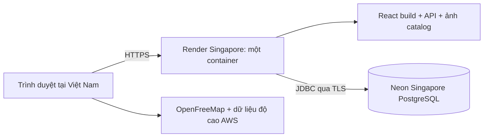

# Nghiên cứu và kế hoạch deploy miễn phí Wander

Ngày nghiên cứu: 30/10/2026. Trạng thái: **PROPOSED**, dành cho bản demo/học tập và sử dụng cá nhân ít truy cập. Đây là kế hoạch kỹ thuật, chưa phê duyệt thay thế ADR-006, chưa tạo tài nguyên hay triển khai. Các phép đo hiệu năng cloud bên dưới là tiêu chí cần đạt, không phải kết quả đã đo.

## 1. Kết luận đề xuất

Chọn **Render Free Web Service (Docker) + Neon Free PostgreSQL**, ưu tiên cả hai ở Singapore nếu dashboard cho phép chọn gói Free tại thời điểm tạo. Một container Spring Boot phục vụ React đã build, API và ảnh catalog cùng origin. Giữ một instance ứng dụng; để dịch vụ ngủ tự nhiên khi không dùng.

Tối ưu ở đây là cân bằng: chi phí 0 USD trong quota, ít sửa source, ít công vận hành, giữ nguyên stack Java/PostgreSQL và dễ chuyển hosting. Không tối ưu cho uptime liên tục hoặc nhiều người dùng đồng thời. Nếu ứng dụng không vượt qua bài đo RAM 512 MiB thì không coi phương án này là khả thi chỉ vì đã build thành công.

Khuyến nghị làm theo hai chặng: chứng minh container chạy trong 512 MiB tại máy trước; sau đó mới tạo môi trường cloud demo và kiểm tra RAM, proxy, cold start, quota thực tế. Chỉ xét phát hành cho người dùng thật sau các release gate của repo.

## 2. Những gì đã xác minh từ source

| Bằng chứng | Hiện trạng | Ý nghĩa khi deploy |
|---|---|---|
| `backend/build.gradle.kts` | Java 21, Spring Boot 4.1.2, MVC/Tomcat, JPA, Flyway, Security, Actuator; JAR cố định `wander-backend.jar` | Chạy JVM/container thông thường; không cần đổi framework |
| `backend/gradle/wrapper/gradle-wrapper.properties` | Gradle 9.8.1 | Dùng wrapper; xác minh tải được đúng phiên bản khi build sạch |
| `web/package.json`, `web/vite.config.ts` | React 19, Vite 8, Node >=24 theo root package; API cùng origin `/api` | Build Node 24, runtime không cần Node |
| `backend/Dockerfile` | Chỉ COPY JAR đã build; Java heap tối đa 75% RAM | Chưa tự build từ Git; 75% có thể chừa thiếu RAM cho JVM native |
| `docker-compose.yml` | Frontend mount từ `web/dist` ở máy; DB local volume | Cloud cần COPY frontend vào image; DB chuyển sang Neon |
| `application.yml` | Port/bind/DB/web dir/pepper cấu hình qua env; chưa có tuning Hikari | Có nền tảng 12-factor, cần profile riêng cho free hosting |
| `WebConfig.java` | SPA fallback; ảnh từ classpath `/catalog/photos/**`; không fallback `/api` và `/actuator` | Gộp FE/BE là đường ít thay đổi nhất |
| `SecurityConfig.java` | Bearer; CORS bị tắt; session stateless | Tách frontend/backend khác origin sẽ thêm việc CORS và auth cần kiểm chứng |
| `ResponseHeadersFilter.java` | API `no-store`; assets immutable; CSP và HSTS | Đã có nền cache/bảo mật; phải kiểm tra header thực tế sau resource handler |
| `ClientAddress.java` | Tự chọn IP từ bên phải X-Forwarded-For theo số hop | Phải xác minh proxy Render, không sao chép cấu hình 2 hop của AWS |
| UI identity | Ghép thiết bị và step-up có polling khi có yêu cầu đang chờ | Cần thử mạng chậm/cold start, tránh gọi chồng và poll sau khi màn đóng |
| `web/src/shared/map/map.const.ts`, `HttpConstants.java` | OpenFreeMap, độ cao AWS; CSP allowlist | Map phụ thuộc mạng ngoài, cần test CSP/CORS thực tế |
| `docs/ci/backend-ci.workflow.yml` | CI mẫu nằm ngoài `.github/workflows` | Chưa thể giả định GitHub đã chạy quality gate |

Đo file hiện có ở workspace, **không phải build sạch của commit sắp deploy**:

- JAR: 127.101.359 byte (~121,2 MiB).
- Catalog photos: 213 file, 68.283.981 byte (~65,1 MiB).
- `web/dist`: 91 file, 3.620.497 byte (~3,45 MiB).

Kích thước JAR không đồng nghĩa lượng RAM sử dụng. Cần đo peak RSS/cgroup; không suy ra OOM từ kích thước file. Workspace đang có thay đổi FE và `.mcp.json`; lúc triển khai phải chốt commit cụ thể để không trộn công việc đang làm.

## 3. So sánh phương án

| Phương án | Điểm mạnh | Giới hạn với Wander | Kết luận |
|---|---|---|---|
| Render Free + Neon Free | Docker, managed HTTPS, có vùng Singapore ở cả hai nhà cung cấp | RAM chật; ngủ khi ít truy cập; quota build/băng thông | Ưu tiên, có bước kiểm chứng trước |
| Koyeb Free + Neon | Chạy container, managed platform | Free 512 MB/0,1 vCPU; chỉ Frankfurt hoặc Washington DC; ngủ sau một giờ | Dự phòng hạ tầng, không giải quyết hạn chế RAM và xa người dùng VN hơn [S6] |
| Oracle Always Free VM | Tự quản, linh hoạt tài nguyên | Khả năng cấp máy tùy vùng; vận hành OS/TLS/backup; rủi ro thu hồi tài nguyên nhàn rỗi | Chỉ khảo sát tiếp nếu muốn học quản trị VM; không làm đường chính [S7] |
| Chỉ deploy React tĩnh | Ít tài nguyên runtime | Không cung cấp backend Java/DB; không đáp ứng lưu và khôi phục trên thiết bị khác | Chỉ hợp demo UI riêng |
| Tách FE sang static hosting, BE Render | FE có thể tải trong lúc BE ngủ | Phải thiết kế routing `/api`, `/catalog`, CORS hoặc proxy và đồng bộ release | Hoãn tới khi số đo chứng minh có lợi |
| AWS ECS/ALB/RDS trong ADR-006 | Đúng hướng học AWS đã chọn | Chưa có nghiên cứu chi phí cho mục tiêu 0 USD | Giữ là hướng AWS riêng, không coi mặc nhiên miễn phí |

Render Free có cơ chế ngủ sau 15 phút, filesystem tạm và 750 instance-hours/workspace/tháng; DB Free riêng của Render hết hạn sau 30 ngày. Vì vậy lưu dữ liệu lâu dài ở Neon và không dựa vào file ghi trong container. Hạn mức và chính sách free phải kiểm lại lúc triển khai. [S1]

Neon Free hiện công bố 100 CU-hours/tháng/project và 1 GB lưu trữ/project; không cần thẻ. Mức 0,5 GB trong thông tin cũ đã thay đổi. [S2]

Render có Singapore; Neon có `aws-ap-southeast-1`. Xác minh dashboard hỗ trợ Free ở vùng mong muốn trước khi tạo vì đổi vùng Render cần tạo service mới. [S3][S4]

## 4. Thiết kế image và build

Thêm Dockerfile cloud riêng ở root, giữ Dockerfile local trong giai đoạn đầu để giảm ảnh hưởng:

1. Stage FE: Node 24; COPY lockfile và manifest trước; `npm ci --prefix web`, rồi COPY source và `npm --prefix web run build`.
2. Stage BE: JDK 21; dùng `backend/gradlew`, COPY wrapper và build metadata trước source khi thực tế có lợi cho cache; `sh ./gradlew --no-daemon bootJar --console=plain`.
3. Stage runtime: JRE 21, user không phải root; COPY JAR vào `/app/app.jar`, FE vào `/app/web`; có CA certificate phù hợp với JDBC TLS. Không cài JDK/Gradle/Node ở runtime.
4. Đặt `WANDER_WEB_DIR=/app/web`, `WANDER_BIND_ADDRESS=0.0.0.0`; ứng dụng đọc `PORT` từ platform. Không ghi cứng port cloud khác với port ứng dụng.
5. Root build context để COPY được cả `web` và `backend`; đường dẫn Dockerfile được cấu hình tường minh trong Render.
6. `.dockerignore` loại `.git`, `.logs`, `.env*`, secrets, node_modules, output build, tài liệu/screenshot không cần, config cá nhân/MCP. Dùng COPY cụ thể thay cho COPY toàn repo khi có thể. Không loại catalog/ảnh runtime cần dùng.
7. Không truyền DB password/pepper bằng Docker ARG, không nhúng vào frontend `VITE_*`, không chạy Spring Boot để build JAR. Kiểm tra image history và build log không chứa secret. Docker khuyến cáo dùng secret mounts nếu thực sự cần bí mật trong build. [S11]

Ưu tiên build trực tiếp trên Render lúc đầu vì ít thành phần. Chạy tests trong CI trước deploy; Docker build không thay thế quality gate. Bắt đầu bằng deploy thủ công một commit đã kiểm, sau đó mới tự động deploy khi CI pass. Tránh deploy mỗi lần push khi workflow còn chưa được thiết lập.

Giữ nguyên lockfile, không cập nhật Java/Boot/Vite đồng thời với triển khai. Kiểm tra clean build trên Linux, executable bit/line ending của wrapper; dùng `sh` nếu cần. Chỉ thêm registry/GHCR build-once nếu quota build hoặc yêu cầu rollback thực tế đáng để tăng độ phức tạp.

## 5. RAM và concurrency: phải đo trước

Thêm profile `application-free.yml`, kích hoạt bằng `SPRING_PROFILES_ACTIVE=free`. Các giá trị dưới đây là **điểm bắt đầu thử nghiệm**, không phải cấu hình đã tối ưu bằng benchmark:

| Tham số | Điểm bắt đầu | Mục đích |
|---|---|---|
| `JAVA_TOOL_OPTIONS` | `-Xms64m -Xmx256m -XX:+ExitOnOutOfMemoryError` | Chừa khoảng trống native heap, metaspace, thread và bộ nhớ cgroup |
| Tomcat threads max / min-spare | 20 / 2 | Giảm số thread nền; kiểm tra khi DB chậm |
| Hikari maximum-pool-size | 3 | Phù hợp demo nhỏ; không đồng nhất với số HTTP request tối đa |
| Hikari minimum-idle | 0 | Cho pool co xuống khi không dùng |
| Hikari idle-timeout | 60000 ms | Đóng kết nối idle sớm |
| Hikari keepalive-time | 0 | Không tạo truy vấn keepalive định kỳ |
| Hikari connection-timeout | 30000 ms | Cho phép chờ DB wake-up có giới hạn |
| Hikari max-lifetime | 1800000 ms ban đầu | Đo reconnect sau idle rồi mới điều chỉnh |

Ý nghĩa pool/idle/keepalive theo HikariCP; cần đối chiếu phiên bản thực tế được Boot resolve. [S8]

Không đặt cứng giới hạn metaspace quá thấp, không bật lazy initialization chỉ để che startup lỗi, không đổi GC trước khi có số đo. So sánh SerialGC chỉ khi baseline không đủ và có bài thử cùng tải chứng minh có lợi. Không chọn GraalVM/native image ở vòng đầu vì tăng phạm vi build và tương thích.

**Bài đo tại máy:** container limit 512 MiB, không swap để tránh kết quả tốt giả; thử khởi động DB rỗng chạy Flyway, khởi động DB đã có schema, xem catalog, mở ảnh, tạo/sửa chuyến, ghép thiết bị; tải 1, 3, 5 người giả lập. DB/container test không đưa vào quota RAM ứng dụng. Đo 30–60 phút, lưu peak memory, restart/OOM count và latency; cloud CPU yếu hơn máy local nên đây chỉ là điều kiện đầu vào.

**Ngưỡng chấp nhận đề xuất:** không OOM/restart; peak cgroup memory dưới khoảng 430 MiB ở tải demo 5 người; còn dư trong migration/startup; warm API p95 dưới 1 giây với thao tác nhỏ tại cloud. Cold start đo riêng, không đưa vào p95 warm. Các ngưỡng là mục tiêu kỹ thuật để duyệt, không phải cam kết hiệu năng.

Nếu thất bại: tìm nguồn tốn RAM/truy vấn trước; giảm pool/thread nếu có bằng chứng; thử heap 224/288 MiB theo số đo. Nếu vẫn không đủ, ghi nhận Free 512 MiB không phù hợp source hiện tại; đánh giá VM free hoặc gói trả phí có thêm RAM, không tiếp tục cắt chức năng/bảo mật để ép chạy.

## 6. Neon, Flyway và tránh hao quota

Cho một instance và pool tối đa 3 connection, **ưu tiên direct connection** để giảm lớp trung gian, giữ Flyway trên đường kết nối thông thường. Chỉ chuyển sang pooled endpoint khi có vấn đề kết nối thực tế; nếu dùng pooled runtime thì cấu hình Flyway direct riêng và chạy test migration đầy đủ. Neon có pooling, nhưng không có lý do đưa thêm nó chỉ vì dịch vụ cung cấp sẵn. [S9]

Các bước DB:

1. Chọn PostgreSQL 17 để gần môi trường `postgres:17-alpine` hiện tại, nếu Neon cung cấp ở project mới.
2. Chọn Singapore; tạo database dành riêng demo. Có thể thêm role migration và role ứng dụng quyền tối thiểu ở bước hardening; không thay cơ chế auth sản phẩm.
3. Chuyển connection string sang JDBC, username/password đưa biến riêng; URL mẫu: `jdbc:postgresql://<direct-host>:5432/<db>?sslmode=verify-full`. Cấu hình CA/trust cụ thể của pgJDBC trong runtime và kiểm chứng hostname/certificate; không hạ TLS khi gặp lỗi CA. `verify-full` xác minh cả chứng chỉ và hostname. [S12]
4. Flyway chạy lúc startup, Hibernate tiếp tục `ddl-auto=validate`. Không tự tạo schema bằng Hibernate, không sửa migration đã chạy.
5. Thử cả DB rỗng và DB có dữ liệu, kiểm checksum/history. Demo một instance có thể migrate khi startup; về sau multi-instance cần xem lại điều phối migration.

**Health check là điểm dễ làm DB chạy liên tục:** Render gọi health thường xuyên. Chọn `/actuator/health/liveness`, xác minh group chỉ kiểm trạng thái JVM/app, không query DB; Docker HEALTHCHECK cũng phải tránh endpoint tổng có DB. Việc startup hoàn tất và Flyway thành công là điều kiện app trở nên sẵn sàng; thử API có DB riêng trong smoke test. Không đưa DB vào probe gọi vài giây một lần chỉ để rồi đánh thức Neon. [S5]

Pool idle/keepalive, validation, polling UI và công cụ monitor đều có thể ảnh hưởng trạng thái idle; cần quan sát thực tế thay vì khẳng định chỉ một connection mở là luôn giữ Neon thức. Neon mô tả tự suspend khi idle; xác minh biểu đồ compute sau 10–20 phút không thao tác. [S10]

Không dùng cron ping chống ngủ. Với giả định DB giữ 0,25 CU liên tục, 30 ngày tiêu khoảng `0,25 × 24 × 30 = 180 CU-hours`, vượt 100 CU-hours free; đây là phép tính minh họa, không phải dự báo tải. Đặt mục tiêu nội bộ dưới 70 CU-hours/tháng, xem quota thực tế sau tuần demo đầu. Poll ghép thiết bị phải dừng khi unmount/hết hạn và không gọi chồng khi mạng chậm.

## 7. Proxy, secret và release gate

| Cấu hình runtime | Giá trị dự kiến |
|---|---|
| `SPRING_PROFILES_ACTIVE` | `free` |
| `WANDER_BIND_ADDRESS` | `0.0.0.0` |
| `PORT` | Render cung cấp, source đã đọc biến này |
| `WANDER_WEB_DIR` | `/app/web` |
| `WANDER_DB_URL` | JDBC direct + TLS đã kiểm chứng |
| `WANDER_DB_USER`, `WANDER_DB_PASSWORD` | Secret runtime |
| `WANDER_RECOVERY_PEPPER` | Secret ngẫu nhiên đáp ứng >=32 byte, giữ ổn định qua redeploy |
| `WANDER_TRUSTED_PROXY_HOPS` | Chưa chốt: phải kiểm đường đi và X-Forwarded-For trên Render |
| `JAVA_TOOL_OPTIONS` | Theo kết quả bài đo RAM |

Không đặt hop=1 chỉ vì thấy một provider. Gửi request từ hai mạng/IP khác nhau, thử header X-Forwarded-For giả và nhiều giá trị; xác minh app chọn IP thật, không bị giả mạo hoặc gom tất cả người dùng vào IP proxy. Nếu dùng cơ chế forward header của framework, phải kiểm tránh biến đổi remote address hai lần với `ClientAddress` hiện có. Log chẩn đoán tạm phải hạn chế dữ liệu, không lộ token/pepper và được gỡ sau kiểm tra.

Secret chỉ nhập runtime provider sau khi triển khai được cho phép, backup pepper trong password manager. Đổi/mất pepper làm hỏng khôi phục danh tính; rotation nhiều phiên bản đang là việc trước phát hành trong `decisions.md`, không được bỏ qua vì hosting miễn phí.

RG-2/5/6/7 hiện còn mở theo hồ sơ repo. Việc demo online không tự đóng các gate này. Kế hoạch không đổi Bearer/localStorage sang cookie, không đổi semantics lưu dữ liệu. Chốt các điểm an ninh/phát hành trước mở cho người dùng thật; kế hoạch hardening là phần riêng của release, không thể suy từ việc URL đã truy cập được.

## 8. Cache, ảnh và băng thông

Giai đoạn đầu giữ ảnh trong classpath để không phát sinh object storage và migration URL. Đo payload thực tế mỗi phiên: user chỉ tải phần ảnh đã xem, không lấy 65 MiB toàn bộ catalog làm mặc định cho mỗi lần mở.

Kiểm tra bằng DevTools/curl trên bản cloud:

- `/api/**`: `Cache-Control: no-store`, token không nằm trong URL/log.
- `/assets/**`: tên hash, cache immutable; xác minh deploy mới không làm client cũ nhận HTML thay JS cũ khi asset đã bị thay.
- `/` và SPA path: HTML revalidate, refresh route mở đúng app.
- `/catalog/photos/**`: kiểm tra header cuối cùng vì filter UI và resource handler cùng đặt cache. Chỉ cache dài immutable nếu URL ảnh được version hóa; hiện chưa kết luận ảnh đã có content hash.
- Tài nguyên không có thật trả lỗi phù hợp; ảnh/JS 404 không bị SPA fallback trả HTML gây lỗi MIME khó hiểu.
- Thử gzip/Brotli hoặc `server.compression` trên text/JSON/JS/CSS sau khi xem header thực tế; không nén lại JPEG/WebP. Đo CPU trên instance free.
- MapLibre worker, tile, glyph, sprite, terrain hoạt động dưới CSP hiện tại; không nới CSP toàn cục để chữa lỗi.

Chỉ thêm CDN/tách static nếu băng thông gần quota hoặc số đo tải ảnh chậm cho thấy lợi ích. Khi đó xử lý API routing, CSP, `/catalog/photos` và release FE/BE cùng lúc, tránh chỉ chuyển `web/dist` rồi để ảnh vẫn chạy qua backend.

## 9. Quản lý chi phí và dữ liệu

Mục tiêu 0 USD nghĩa là nằm trong quota, không đồng nghĩa vô hạn. Khi không có payment method, Render mô tả dịch vụ Free bị suspend nếu hết bandwidth; build mới bị dừng nếu hết pipeline minutes. Nếu thêm payment method phải kiểm chính sách overage/spend limit trước. [S1]

Không đóng đinh quota bandwidth/build từ bài blog cũ: đối chiếu trang pricing và số hiện trong workspace khi tạo. Ghi baseline gồm RAM, instance hours, bandwidth, build minutes, Neon CU-hours, DB size/network transfer. Cảnh báo vận hành nội bộ ở 70%, dừng phát tán demo ở 90%; các ngưỡng là quy ước đề xuất. Không giả định provider cho cấu hình alert miễn phí ở mọi chỉ số.

Backup đề xuất cho demo: `pg_dump` dạng custom trước migration và sau đợt nhập dữ liệu quan trọng, tối thiểu hàng tuần nếu có sử dụng. Dùng client tương thích PostgreSQL 17, mã hóa file và lưu ngoài container/repo. Đặt mục tiêu RPO <=7 ngày, RTO <=2 giờ cho demo, cần chủ dự án đồng ý vì có thể mất dữ liệu trong cửa sổ đó. Restore drill sang DB test trước khi tin backup; quota free/restore history của provider không thay thế bản dump đã thử khôi phục.

Backup DB và pepper là hai thứ đều phải có để khôi phục đầy đủ. Không đưa dump thật vào GitHub Actions artifact công khai. Thu thập ít log, không bật SQL debug trên cloud; TTL log/backup và chính sách xóa dữ liệu cho người dùng thật phải được quyết ở RG-5/OQ-1.

## 10. Công việc triển khai và tiêu chí hoàn tất

Danh sách này thuộc riêng kế hoạch deploy; không thay `plan.md`/`todo.md` UI/UX đang còn việc mở. Mọi ô vẫn mở vì lần này chỉ nghiên cứu và lập kế hoạch.

| ID | Việc và phạm vi file dự kiến | Phụ thuộc | Tiêu chí nghiệm thu / kiểm chứng |
|---|---|---|---|
| D0 | Chốt commit, baseline, ghi giới hạn provider vào báo cáo deploy | Không | Working tree/commit rõ ràng; clean build Linux dùng đúng lockfile và wrapper; thống kê artifact mới |
| D1 | Root Dockerfile cloud + `.dockerignore` | D0 | Build từ source sạch; FE/API/catalog cùng container; chạy non-root; image không có secret/dev output |
| D2 | `application-free.yml`, env mapping cần thiết; health path container | D1 | Probe không query DB; pool co về 0; app đọc PORT/bind; cấu hình local mặc định không bị đổi |
| D3 | Bài đo RAM có script/tài liệu và báo cáo kết quả | D2 | 512 MiB không swap; cold/warm/migration/tải demo đạt mục 5 hoặc có quyết định đổi phương án |
| C1 | Checkpoint đóng gói | D1–D3 | Có image chạy được, số đo và smoke local; chưa cần account cloud để tìm lỗi đóng gói |
| D4 | Chuẩn bị CI dựa mẫu repo, bổ sung FE checks | C1 | BE `check`; FE typecheck/lint/test/build; image smoke; secret scan; report gắn đúng commit; CI không tự deploy PR |
| D5 | Chuẩn bị manifest Render/runbook Neon, env placeholders | C1 | Root context, Dockerfile, region, plan Free, probe và biến secret rõ; chưa hardcode hop/credential |
| D6 | Tạo môi trường demo cloud và nhập secret runtime | D4,D5 + cho phép triển khai | Chọn đúng gói Free và vùng; JDBC TLS; Flyway chạy; app/ảnh/API truy cập HTTPS |
| D7 | Xác minh proxy và bảo mật thực tế | D6 | Hai IP có bucket đúng; XFF giả không vượt rate limit; 401/CSP/cache đúng; log không lộ secret |
| D8 | Cloud smoke, cold start và quota idle | D7 | Thử hai thiết bị/khôi phục; app ngủ rồi wake; Neon idle đúng; lưu RAM/latency/quota thực tế |
| C2 | Checkpoint demo | D6–D8 | Không OOM; dữ liệu sống qua redeploy; không có poll/health làm DB hoạt động vô cớ; ghi hạn chế demo |
| D9 | Backup/restore và rollback drill | C2 | Restore DB test được; cùng pepper khôi phục đúng; deploy commit cũ với schema tương thích thành công |
| D10 | Runbook và theo dõi tuần đầu | D9 | Ghi account/resource IDs, quota, cách deploy/rollback/restore, số đo và phương án khi vượt ngưỡng |

D4 và D5 có thể làm song song sau khi image/profile ổn định. D6–D9 tuần tự vì phụ thuộc trạng thái cloud/DB. Khi làm code, mỗi D chia nhỏ tiếp nếu vượt khoảng 5 file hoặc hai giờ tập trung. Ước lượng sơ bộ: 2–4 ngày làm việc cho demo đã kiểm chứng, tùy lỗi RAM/TLS/account; chưa gồm đóng release gate và thời gian quan sát tuần đầu.

### Bộ kiểm tra bắt buộc khi thực hiện

1. Backend: `cd backend`, `./gradlew check --console=plain` trên Linux có Docker cho Testcontainers. Windows dùng `gradlew.bat`. Không chỉ `bootJar` rồi báo tests pass.
2. FE: `npm ci --prefix web`, typecheck, lint, test, build theo scripts hiện tại.
3. E2E: dùng runner/harness thật của repo và Chromium phù hợp môi trường CI; không giả định các test hiện tại tự chạy được trên Linux khi vốn dùng Edge/Chrome local.
4. Smoke image: `/`, một SPA route, `/assets`, ảnh catalog, API public, API private thiếu token, health liveness. Health tổng và readiness xem riêng để phát hiện DB down mà không dùng làm keepalive.
5. Luồng dữ liệu: tạo danh tính/chuyến/ngày/mục, sửa chi phí, xóa/hoàn tác, mở thiết bị khác, ghép thiết bị, khôi phục; dữ liệu còn sau restart/redeploy.
6. Lỗi: DB chưa thức, DB tạm không truy cập được, request chậm, token sai, mất mạng khi poll, hai request ghi đồng thời; không retry mù mutation tạo trùng dữ liệu.
7. Mobile thật Safari/Android và mạng yếu, map/ảnh/terrain/CSP; ghi phần chưa kiểm rõ ràng.

## 11. Deploy, rollback và lối ra

Runbook deploy: chốt SHA → CI pass → backup khi có schema mới → deploy một instance → chờ Flyway/startup → smoke API/FE → quan sát RAM/log → ghi phiên bản và kết quả. Demo có thể gián đoạn ngắn; không hứa zero downtime cho gói free.

Rollback app là deploy lại phiên bản trước có artifact/source xác định. Không sửa/xóa `flyway_schema_history` hoặc tự chạy down migration. Chỉ rollback app khi schema backward-compatible; nếu không, forward-fix hoặc restore DB với mức mất dữ liệu đã được chấp nhận. Health đỏ ở cold start không phải lý do lập tức restore DB.

Lối ra theo bằng chứng:

- RAM không đạt sau vòng tuning có giới hạn: xem hosting thêm RAM; Koyeb Free cùng 512 MB không được coi là giải pháp tự động.
- Người dùng không chấp nhận cold start: cần compute luôn chạy; nếu DB giữ hoạt động liên tục phải dự toán cả Neon compute thay vì chỉ nâng backend.
- Ảnh/bandwidth đạt 70% quota: đo ảnh nào tốn nhất, resize/định dạng/version URL trước; sau đó mới thêm CDN/object storage.
- DB storage/compute gần quota: kiểm query/poll/health và dữ liệu rác theo chính sách được duyệt; không tự xóa dữ liệu người dùng để né phí.
- Cần production: xử lý RG-2/5/6/7, backup/rotation/retention, theo dõi và chi phí; quyết định tiếp Render hay quay hướng AWS ADR-006 bằng hồ sơ riêng.

## 12. Quyết định còn cần khi bắt đầu triển khai

1. Dùng Render + Neon cho môi trường demo riêng, giữ hướng học AWS trong ADR-006.
2. Chấp nhận cold start và không có SLA; dùng dữ liệu demo tới khi các release gate hoàn tất.
3. Chấp nhận ngưỡng đo RAM/tải và phương án dừng nếu 512 MiB không đủ.
4. Chọn chính sách backup/retention và nơi giữ pepper; phạm vi cho phép tạo resource/pipeline phải rõ trước thao tác cloud.

Chưa cần các quyết định này để hoàn tất nghiên cứu. Không có phép đo cloud hoặc test runtime mới nào được chạy trong lần lập kế hoạch này.

## 13. Nguồn chính thức

Các trang đã tra ngày 30/10/2026; kiểm lại chính sách tại thời điểm triển khai:

- [S1 — Render Free: idle, quota, filesystem, DB expiry và xử lý khi không có payment method](https://render.com/docs/free).
- [S2 — Neon pricing: gói Free 1 GB và 100 CU-hours/project](https://neon.com/pricing).
- [S3 — Render regions và giới hạn đổi vùng](https://render.com/docs/regions).
- [S4 — Neon regions](https://neon.com/docs/introduction/regions).
- [S5 — Render health checks](https://render.com/docs/health-checks).
- [S6 — Koyeb instances: thông số và vùng Free](https://www.koyeb.com/docs/reference/instances).
- [S7 — Oracle Cloud Free Tier FAQ: khả năng cấp máy và account idle](https://www.oracle.com/cloud/free/faq/).
- [S8 — HikariCP: minimumIdle, idleTimeout, keepaliveTime và connectionTimeout](https://github.com/brettwooldridge/HikariCP).
- [S9 — Neon connection pooling](https://neon.com/docs/connect/connection-pooling).
- [S10 — Neon scale to zero](https://neon.com/docs/introduction/scale-to-zero).
- [S11 — Docker build variables: bảo vệ secret trong build](https://docs.docker.com/build/building/variables/).
- [S12 — pgJDBC SSL: xác minh certificate và hostname](https://jdbc.postgresql.org/documentation/ssl/).
- [Render pricing — xác nhận quota theo workspace khi tạo](https://render.com/pricing).
- [Render Docker — build context, environment và đóng gói](https://render.com/docs/docker).

**Công cụ đã dùng:** đọc source/cấu hình bằng PowerShell và ripgrep; tra web nguồn chính thức; apply_patch để viết báo cáo. Không gọi agent chuyên môn, không chạy test ứng dụng, không đổi code runtime, không tạo tài nguyên cloud. Chỉ thêm tài liệu này; master plan, ADR và checklist UI/UX giữ nguyên.
