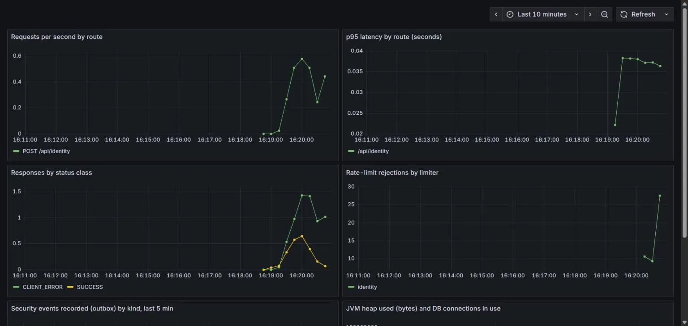

# Observability

What the backend tells you about itself, and how to look at it. Everything on this page was run and checked on 12/11/2026 (see "What was verified").

## 1. Follow one request: `X-Request-Id`

Every response carries an `X-Request-Id` header. If the caller sends one (1–64 characters from `A-Z a-z 0-9 . _ -`) it is kept, so a client can correlate its own trace id; anything else is replaced by a random UUID. The same id is

- in the logging context, so **every log line written while the request is handled** carries it;
- in the body of every error, as the `requestId` member of the RFC 9457 problem (see [ADR-017](../architecture/adr/ADR-017-typed-api-contract.md)), so a user can quote it from a bug report;
- on the one line logged when the request is finished.

```
$ curl -si -H 'X-Request-Id: demo-trace-1' http://localhost:8787/api/trips | grep -iE '^(HTTP|x-request-id)'
HTTP/1.1 401
X-Request-Id: demo-trace-1
```

```json
{"detail":"Cần phiên hợp lệ.","status":401,"title":"Unauthorized","type":"urn:wander:problem:unauthenticated","code":"UNAUTHENTICATED","requestId":"6546b304-c2c2-44e4-8e4a-6f8a6a0e96a7"}
```

What is logged per request, and what is deliberately not: method, **route template** (`/api/trips/{tripId}`, never the real path, which can contain identifiers), status and duration. Query strings, headers (so no session token) and bodies are never logged. Static files and health probes are logged at DEBUG, API calls at INFO.

Known limitation: a request refused by Spring Security (401) never reaches routing, so its `route` is `unmatched`.

## 2. Logs: JSON on the public deployment

Profile `free` (the Render deployment) switches on Spring Boot's structured logging in ECS format, one JSON object per line, so Render's log search can filter on fields. Local runs keep the readable text format. One real line, captured by running the jar with `SPRING_PROFILES_ACTIVE=free` against a local database:

```json
{"@timestamp":"2026-11-12T09:16:18.194424100Z","log":{"level":"INFO","logger":"com.wander.shared.web.filter.RequestIdFilter"},"process":{"pid":20152,"thread":{"name":"http-nio-127.0.0.1-8787-exec-2"}},"service":{"name":"wander-backend","version":"0.1.0","node":{}},"message":"http request completed","requestId":"6bf90498-392d-416a-8bb5-954dc5368978","method":"POST","route":"/api/identity","status":201,"durationMs":215,"ecs":{"version":"8.11"}}
```

## 3. Metrics: Prometheus

`/actuator/prometheus` is exposed **outside** the `free` profile only (local runs, compose). On the public instance it is not exposed (404, checked), because anyone could read it.

| Metric | Meaning |
|---|---|
| `http_server_requests_seconds_*` (with histogram buckets) | Count and latency of every HTTP request, tagged by `uri` (route template), `method`, `status`, `outcome` |
| `wander_ratelimit_rejected_total{limiter}` | Calls refused by a rate limiter (`identity`, `recovery`, `approval`, `catalog`, `pairing-request`, `step-up-request`, `writes`, `link-poll`) |
| `wander_identity_events_recorded_total{kind}` | Security events appended to the activity log by the outbox listener ([events.md](../architecture/events.md)) |
| `wander_identity_events_duplicate_total` | Deliveries of an already-recorded event that the idempotent recorder ignored |
| `jvm_*`, `hikaricp_*`, `tomcat_*` | JVM memory, GC, DB pool, threads (Spring Boot defaults) |

## 4. See it: Prometheus + Grafana in Docker

```
make run                                                   # backend on :8787 (default profile)
docker compose --profile observability up -d prometheus grafana
```

- Prometheus: <http://localhost:9090> (scrapes `host.docker.internal:8787` for a backend run on the host, and `backend:8787` for `docker compose --profile app`; one of the two targets is always down, which is expected).
- Grafana: <http://localhost:3000> opens the dashboard **Wander backend** without a login (read-only, bound to 127.0.0.1); the admin account is `admin` / `wander`, for local use only.
- Stop: `docker compose --profile observability down`.



The dashboard (`observability/grafana/dashboards/wander-backend.json`, provisioned from files) has six panels: requests per second by route, p95 latency by route, responses by status class, rate-limit rejections by limiter, security events recorded and duplicate deliveries, JVM heap and DB connections. The screenshot above was taken from a real run; the rate-limit curve is real too (a loop creating identities hit the `identity` limiter).

## What was verified

Run on 12/11/2026 with the jar built from this branch:

- `ObservabilityIT` and `RateLimitMetricsTest` (part of `./gradlew check`): generated and echoed request id, invalid ids replaced, `requestId` equal to the header in 400/404/401 bodies, Prometheus text contains the route-tagged HTTP metrics and the identity counter, `application-free.yml` has JSON logs and exposes only `health`, counters per limiter.
- Jar with profile `free` against local Postgres: JSON log lines as above; `/actuator/prometheus` 404, `/v3/api-docs` 404, `/actuator/health` 200.
- Jar with the default profile plus compose: Prometheus target `host` up; `sum(wander_identity_events_recorded_total)` and the `/api/identity` request count both returned the 3 events/requests sent; Grafana health OK and the provisioned dashboard found by the search API.

## Not done

- No tracing (OpenTelemetry) and no alert rules: the system is one process, and `X-Request-Id` plus structured logs cover the debugging need.
- Nothing is scraped on the public instance; to see production numbers you would add a managed Prometheus/Grafana, which is a cost and infrastructure decision (Tier A), not made here.
- `event_publication` rows that stay `FAILED` are not exposed as a metric yet.
